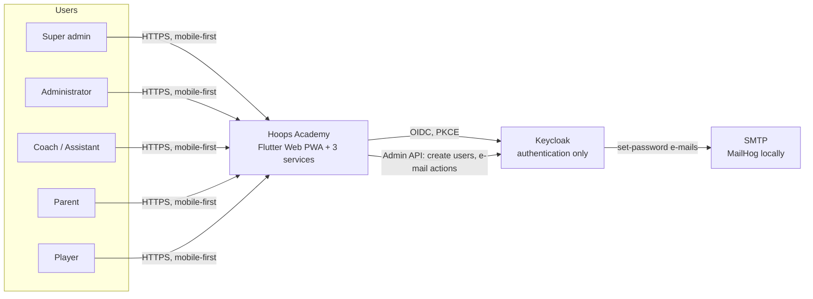
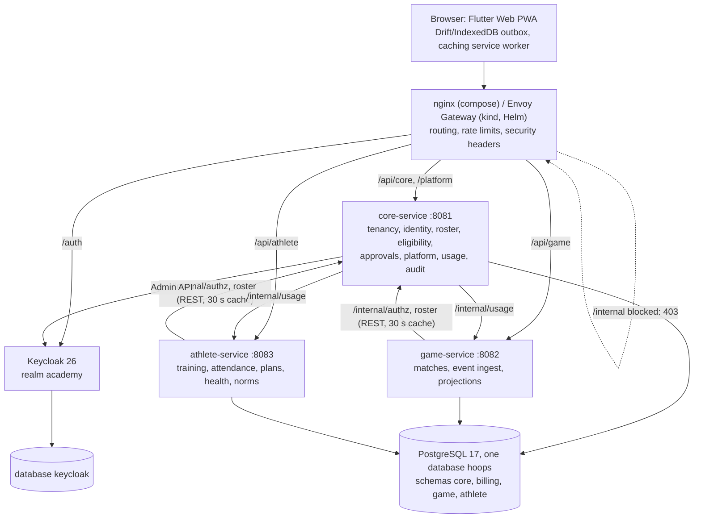
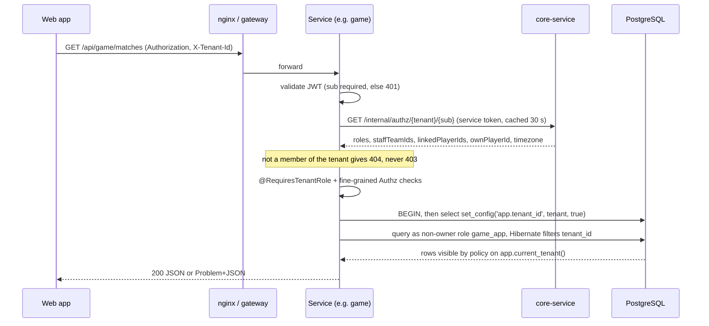
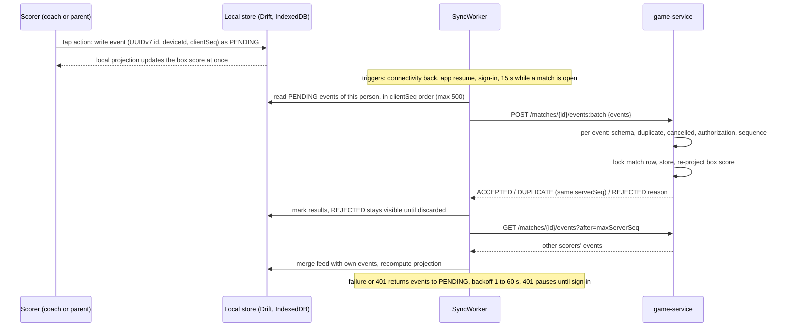
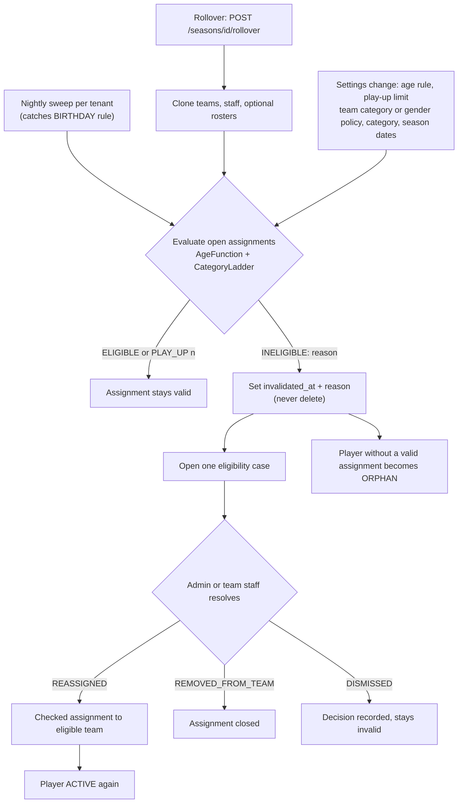

# Architecture overview

Hoops Academy is a multitenant platform for basketball academies: roster and age-category eligibility, offline-first live
match statistics, training and attendance, athlete health and fitness. The full plan is `PLAN.md`; decisions are in
`adr/`. This page is the map. Diagrams are Mermaid (rendered by GitHub and most Markdown viewers).

## 1. System context

## 2. Containers and services

Locally: `podman compose` (Postgres, Keycloak, MailHog, nginx on :8080) plus the three services on the host. On kind: Helm
umbrella chart `hoops`, CloudNativePG clusters, Keycloak, Envoy Gateway (Gateway API, ADR-0031) on :8090 (`runbooks/kind.md`). A fourth `web` image
(nginx-unprivileged) serves the PWA there.

## 3. Request flow: tenant header and row-level security

Two independent isolation layers (ADR-0006, ADR-0011): Hibernate discriminator filter and Postgres RLS (`ENABLE` + `FORCE`)
whose function `app.current_tenant()` raises when the variable is unset, so a forgotten tenant is a loud error. `/me` and
`/platform/**` carry no tenant header; `/internal/**` requires the `service` role and is blocked at the proxy.

## 4. Live match with offline sync

Idempotency key is the client event id; `(match, deviceId, clientSeq)` is unique. The server validates schema and
authorization only, never game consistency; contradictions become projection warnings that staff fix with VOID
(ADR-0014). The Dart projector mirrors the Java one and both pass the same vectors (`libs/contracts/vectors`).

## 5. Eligibility and season rollover

Reasons: `CATEGORY_TOO_LOW`, `PLAY_UP_LIMIT_EXCEEDED`, `GENDER_POLICY`, `MISSING_BIRTH_DATE`, `MISSING_GENDER`,
`PLAYER_NOT_ACTIVE`. Details: ADR-0010, ADR-0015.

## 6. Key decisions
| Topic | Decision | ADR |
|---|---|---|
| Repository | monorepo, kept outside OneDrive | [0001](adr/0001-repo-outside-onedrive.md), [0002](adr/0002-monorepo.md) |
| Backend | Java 21, Quarkus 3, hexagonal layers enforced by ArchUnit | [0003](adr/0003-quarkus.md) |
| Frontend | Flutter Web PWA, no Node; Drift offline queue | [0004](adr/0004-flutter-web-pwa.md) |
| Identity | Keycloak authenticates; tenant roles live in `core.membership_role` | [0005](adr/0005-keycloak-authentication-only.md) |
| Isolation | shared schema, `tenant_id` + RLS + Hibernate filter, non-owner app roles | [0006](adr/0006-rls-multitenancy.md), [0011](adr/0011-tenant-binding-in-transactions.md) |
| Services | three: core, game, athlete | [0007](adr/0007-three-services.md) |
| Integration | synchronous REST behind `RosterPort` now; outbox + Redpanda later | [0008](adr/0008-sync-rest-then-outbox.md) |
| Logo | stored in Postgres, ETag cached | [0009](adr/0009-tenant-logo-in-postgres.md) |
| Age rule | `BIRTH_YEAR` default, `BIRTHDAY` optional | [0010](adr/0010-age-rule-birth-year-default.md) |
| Secrets on Kubernetes | Secrets referenced by name; ESO beyond local | [0012](adr/0012-kubernetes-secrets-strategy.md) |
| Onboarding | saga with compensation; membership index for `/me` | [0013](adr/0013-core-onboarding-saga-and-membership-index.md) |
| Match events | idempotent batch ingest, projections, VOID | [0014](adr/0014-match-event-ingest-and-projection.md) |
| Eligibility | sticky invalidation, cases, rollover | [0015](adr/0015-roster-eligibility-engine-and-rollover.md) |
| Contracts 2.0 | shared core client, job lock | [0016](adr/0016-wp2c-consolidation-contracts-2-shared-core-client-job-lock.md) |
| Audit and hardening | append-only audit trail, headers, limits | [0017](adr/0017-audit-trail-observability-and-http-hardening.md) |
| Web offline shell | own caching service worker, no CDN, update prompt | [0018](adr/0018-web-offline-shell-service-worker.md) |
| Web session | no `offline_access`, local-first sign-out, offline DB wipe | [0019](adr/0019-web-session-and-sign-out.md) |
| Approvals | pending player rows, REJECTED, ORPHAN on creation, player login | [0020](adr/0020-approval-workflow-and-player-lifecycle.md) |
| Authz refinements | assistant rights, match/feed visibility, team-scoped health data | [0021](adr/0021-authorization-refinements-beyond-the-matrix.md) |

Not done as planned: WP19 (outbox, Redpanda, replica tables) has a brief only; billing exists as seams
(`billing.plan`, `billing.tenant_subscription`, a no-op `EntitlementService`). See `roadmap.md`.

## 7. Data ownership
| Schema | Owner service | Main tables | App role / migrator |
|---|---|---|---|
| `core` | core-service | `tenant`, `tenant_settings`, `tenant_logo`, `app_user`, `person`, `membership_role`, `user_membership_index`, `player`, `guardian_link`, `season`, `age_category`, `team`, `team_player`, `team_staff`, `eligibility_case`, `approval_request`, `usage_snapshot`, `outbox`, `audit_event` | `core_app`, `core_platform` (registry, usage, billing, audit insert only) / `core_migrator` |
| `billing` | core-service | `plan`, `tenant_subscription` | `core_platform` / `core_migrator` |
| `game` | game-service | `match`, `match_roster`, `match_event` (append-only), `match_player_stats`, `match_summary` projections | `game_app` / `game_migrator` |
| `athlete` | athlete-service | `training_schedule`, `training_session`, `training_plan` (templates have no tenant), `plan_item`, `plan_assignment`, `plan_completion`, `planned_absence`, `attendance`, `injury`, `body_measurement`, `physical_test_type`, `physical_test_result`, `physical_test_norm` | `athlete_app` / `athlete_migrator` |
| database `keycloak` | Keycloak | users, credentials, sessions | role `keycloak` |
Cross-service reads go through `RosterPort` (REST to core `/internal`); no service reads another schema. game denormalises
player names at roster creation so offline sync never depends on core. The exact table lists are authoritative in each
service's Flyway migrations.

## 8. Testing strategy and current counts
Counts are from the CI `ci` run 42112940234 on 3b59360 (`main` after WP37 and WP36, 2026-11-05 21:28 UTC; surefire and
`flutter test` reports); they equal the fresh local runs in the WP37 handover (JVM) and after WP35 (Flutter). They
change with every commit.

| Layer | Kinds of test | Count |
|---|---|---|
| `libs/common-quarkus` | unit, `@QuarkusTest` with Testcontainers Postgres as the non-owner role, RLS meta/isolation suites shipped as a test-jar, ArchUnit rules, Problem+JSON | 186 |
| `libs/contracts` | OpenAPI convention tests, JSON Schema validity and examples, OpenAPI/JSON Schema consistency, strict generator validation, strict-validator compatibility (no `allOf`, ADR-0027) | 146 |
| `services/core-service` | domain unit and jqwik property tests (eligibility), REST role-matrix tests, cross-tenant 404, RLS suites per table, responses and requests validated against `core.yaml`, scheduler tests, cross-tenant access through real Keycloak, database role meta test, Keycloak Testcontainers (opt-in profile) | 770 |
| `services/game-service` | domain/projection tests with shared vectors, feed visibility (ADR-0030), ingest API tests, WireMock peers, RLS suites, contract validation | 255 |
| `services/athlete-service` | domain, norm seed and band resolver tests, role matrix, RLS suites (incl. nullable-tenant tables), contract validation | 613 |
| `apps/web` | `flutter test`: unit, provider, widget per role and state, goldens (360 px), projector vectors, sync worker, sign-out, service worker / CSP / build guards, l10n key parity | 608 |
| `e2e` | black-box journey through the gateway with real Keycloak logins: 21 ordered steps, two tenants, every request and response validated against the OpenAPI | 21 steps, green on compose (CI) and on kind (WP36) |
| Chart/infra | `deploy/helm/tests/run.sh`: lint, snapshots, kubeconform, Gateway API route and policy assertions, gitleaks; `deploy/kind/ratelimit-check.sh` on kind | script |
| Mutation (on demand) | PIT per module (`just mutation [module]`, workflow `mutation.yml` manual + monthly; never in `verify`), baselines 95 / 95 / 95 / 100 % for common / core / game / athlete; see [`quality/mutation.md`](quality/mutation.md) | scores 99.1 / 99.6 / 99.5 / 100 % (WP37) |

JVM total: **1,970 tests** (0 failures), line coverage above the gates (80 % overall, 90 % in `domain`). Flutter:
**608 tests**, analyze clean. e2e: **21/21 green on compose** in every CI `e2e` run on `main` (last: run 42112940232 on
3b59360) and **green on kind** for the first time in WP36 (21 tests, 159 s, through the Envoy Gateway on :8090).
Mutation: the `mutation` workflow (run 42112955113 on 3b59360, manual) passed for all four modules. Browser-level checks: `apps/web/tool/web_smoke.sh` runs locally with a
hand-installed chromedriver (last green in WP35, mock mode); Lighthouse and the airplane-mode reload have not run.
Statement-by-statement evidence: [`conformance.md`](conformance.md).

## 9. Security posture
- Authentication: Keycloak, PKCE for the web client, password policy (12+ characters), brute-force protection. Tokens must
  carry `sub`. Platform role `super_admin` is the only role in Keycloak.
- Authorization: tenant filter (404 for non-members), `@RequiresTenantRole`, fine-grained checks, RLS; the oracle is
  [`domain/authz-matrix.md`](domain/authz-matrix.md) and role-matrix tests.
- Network: `/internal/**` blocked at the proxy and by NetworkPolicy; rate limits (429); security headers and CSP; Keycloak
  admin console hidden unless explicitly exposed.
- Data: non-owner DB roles without `BYPASSRLS`; append-only audit trail ([ADR-0017](adr/0017-audit-trail-observability-and-http-hardening.md)); no PII in audit metadata; Problem+JSON without stack traces.
- Supply chain: gitleaks (pre-commit and CI), Trivy (filesystem and images), dependency-check (CI, needs an NVD key), non-root
  images.
- Findings (status 2026-11-06): 18 fixed (F-01 in WP33, F-23 in WP32, F-03/F-09/F-10/F-19/F-20 in WP14b); partly fixed
  F-07 (offline DB scoping) and F-08 (refresh-token rotation); accepted F-11 and F-22 by design (ADR-0025) and F-14
  (token audience) for now.
- Edge: nginx locally; Gateway API with Envoy Gateway in the chart (ADR-0031): per-IP global rate limits shared by
  every Envoy replica (Envoy Gateway's rate limit service with a Redis counter store, one-minute windows; fail open when
  Redis is down, ADR-0033), `/internal` and the Keycloak admin console routed to a 403, HSTS on the HTTPS listener; no
  body-size limit at the gateway (the services reject bodies above 2 MB, accepted in ADR-0033).
Documents: [`security/review-2026-11.md`](security/review-2026-11.md) (23 findings: 0 critical, 0 high, 6 medium),
[`security/threat-model.md`](security/threat-model.md), [`security/asvs-checklist.md`](security/asvs-checklist.md).
