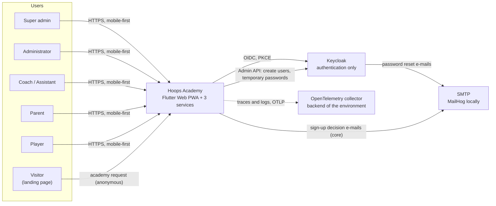
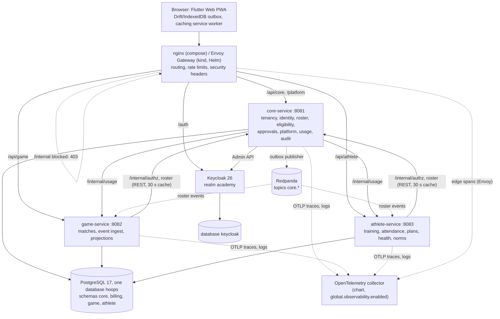
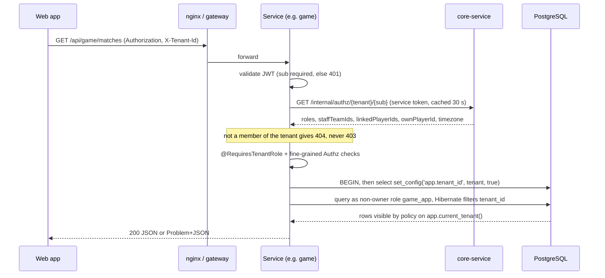
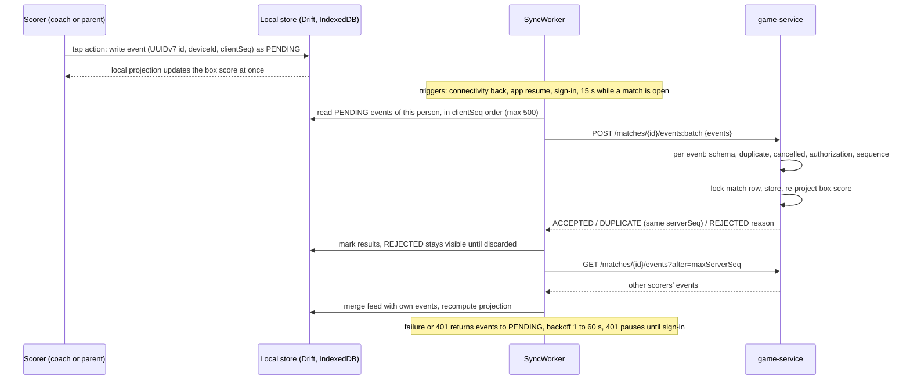
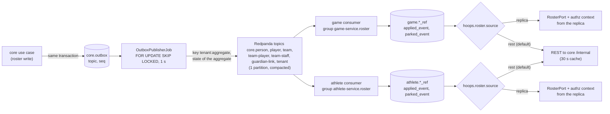
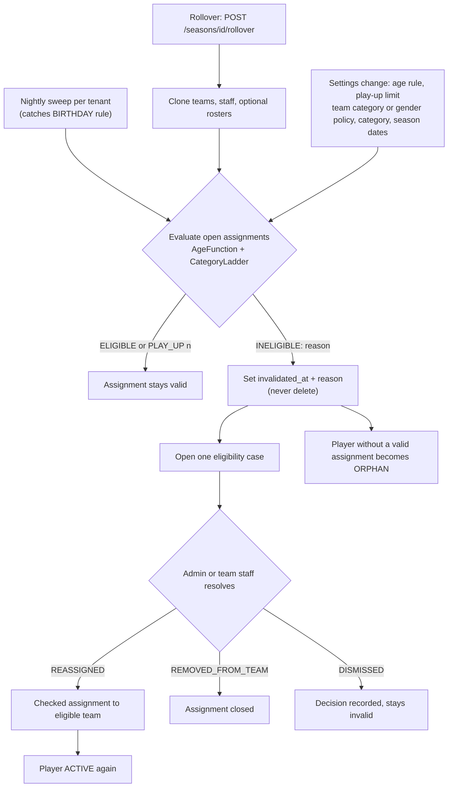
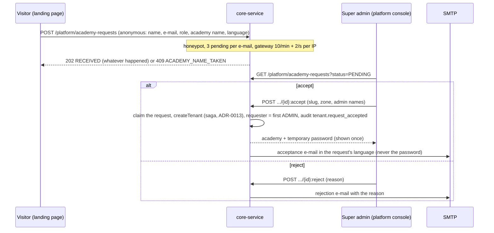

# Architecture overview

Hoops Academy is a multitenant platform for basketball academies: roster and age-category eligibility, offline-first live
match statistics, training and attendance, athlete health and fitness. The full plan is `PLAN.md`; decisions are in
`adr/`. This page is the map. Diagrams are Mermaid (rendered by GitHub and most Markdown viewers).

## 1. System context

## 2. Containers and services

Dotted arrows between core, Redpanda and the services are the v2 event path (section 5): built and running, but game
and athlete still read through REST unless `hoops.roster.source=replica`. Dotted arrows to the collector exist only in
the chart with `global.observability.enabled` (section 11).
Locally: `podman compose` (Postgres, Keycloak, MailHog, Redpanda on :19092 without auth, nginx on :8080) plus the three
services on the host. On kind: Helm umbrella chart `hoops` (0.9.0), CloudNativePG clusters, Keycloak, Mailpit (Service
`mailhog`), Envoy Gateway (Gateway API, ADR-0031) on :8090 with its rate limit service and the chart's in-memory
`ratelimit-redis` (global rate limits with per-minute and per-second rules; Redis ACL user `ratelimit`, ADR-0033 and
its amendment), and one Redpanda node behind `events.enabled` (section 5) (`runbooks/kind.md`). Secrets come from
`.env` through `deploy/kind/secrets.sh`, or from the External Secrets Operator when `externalSecrets.enabled` is set
(`ExternalSecret`s against a `ClusterSecretStore`; kind: `up.sh --eso` with a Kubernetes-provider store; ADR-0012
amendment); with `global.reloader.enabled` a Stakater Reloader controller (installed by `up.sh`, namespaced) rolls every
workload that reads a rotated Secret (ADR-0012 amendment WP87); with `global.observability.enabled` an OpenTelemetry
collector receives the services' traces and logs and Envoy's edge spans, with Jaeger in memory on kind (ADR-0046). A
fourth `web` image (nginx-unprivileged) serves the PWA there; its anonymous root is a public landing page (es/en/id,
language switch in the header, screenshots per locale) with sign-in and the academy request form (section 7). Without any backend the web app runs in demo mode
(`--dart-define=HOOPS_MOCK_API=true`): an in-process mock serves `/api/core`, `/api/game`, `/api/athlete` and
`/platform` through the generated clients, so every screen is reachable (the demo user is a super admin unless
`HOOPS_MOCK_SUPER_ADMIN=false`). The mocks share one roster per academy (the core mock owns teams,
players and guardian links; the athlete and game mocks read it) and filter by role per the authz matrix
(`lib/core/mock/mock_authz.dart`; `HOOPS_MOCK_ROLES` switches roles in the demo academy). The web code is formatted
with `dart format` (80 columns, generated packages excluded; `just web-format-check` runs in CI). Every screen is
built from one design system (ADR-0040): tokens in `lib/core/design/` (`HoopsColors` light and dark, spacing, radii,
type), a token-mapped Material 3 theme in `lib/app/theme.dart` and the shared kit `lib/core/ui/kit.dart` (`PageBody`,
`PageHeader`, `SectionCard`, `ListRow`, `StatusChip`, `StatTile`, `EmptyState`, action sheets); the rules and the
checklist for new screens are in `apps/web/README.md` "Design system".

## 3. Request flow: tenant header and row-level security

Two independent isolation layers (ADR-0006, ADR-0011): Hibernate discriminator filter and Postgres RLS (`ENABLE` + `FORCE`)
whose function `app.current_tenant()` raises when the variable is unset, so a forgotten tenant is a loud error. `/me` and
`/platform/**` carry no tenant header (the one anonymous operation is `POST /platform/academy-requests`, ADR-0044);
`/internal/**` requires the `service` role and is blocked at the proxy. Every refusal on this path (no token, invalid
token, not a member, tenant mismatch, missing role, fine-grained check) writes one structured `hoops.security` event
and counts `hoops_authz_denied_total{kind}` (ADR-0043). **Past seasons** (ADR-0042): the authz context also carries
`historicStaffTeamIds`; a team whose season has ended is readable by its former staff and admins, and every write on it
answers 409 `SEASON_ENDED` (match events recorded after the season's last day are REJECTED).

## 4. Live match with offline sync

Idempotency key is the client event id; `(match, deviceId, clientSeq)` is unique. The server validates schema and
authorization only, never game consistency; contradictions become projection warnings that staff fix with VOID
(ADR-0014). The Dart projector mirrors the Java one and both pass the same vectors (`libs/contracts/vectors`).

## 5. Roster events (v2, behind a switch)

- **Producer (ADR-0008 amendment, WP67).** Every roster change appends its aggregate's full current state to
  `core.outbox` in the writer's transaction; a scheduled publisher sends pending rows in outbox order per aggregate
  (row locks + a head-of-line rule, no cluster lock), at least once, with a tombstone after `.removed`. A broker outage
  leaves the API working and the publisher's readiness `UP` with state `DEGRADED`; after consecutive failed sends the
  publisher replaces its `KafkaProducer`, so it recovers by itself when its broker user appears late (WP81). Every
  aggregate has a `.removed` event; `POST /platform/events/backfill` (`just events-backfill`) appends one `.changed` per
  aggregate older than the publisher. Event contracts: `libs/contracts/events/core.<aggregate>.schema.json`.
- **Broker (ADR-0036, WP66).** One Redpanda node, topics `core.<aggregate>`, key `<tenant id>:<aggregate id>`,
  compacted (replay from the start rebuilds a replica). In the chart: SASL/SCRAM user per service, prefixed ACLs, a
  NetworkPolicy, a bootstrap Job.
- **Replicas (ADR-0037, WP68, WP69).** game and athlete apply each event in the event's tenant (RLS tenant tables),
  skip known `eventId`s, never let an older `occurredAt` win, keep removals soft and park invalid records in a
  write-only table. `hoops.roster.source=rest|replica` (default `rest`) selects both the `RosterPort` and the
  authorisation context resolver; the consumer runs in both modes, so the replica fills in the shadow. A consumer that
  exhausts its retries turns the pod's health DOWN. Removals are soft (identity kept, state nulled, reads treat the row
  as absent; a tenant removal is marked, not cascaded); a nightly retention job per service prunes `applied_event`
  after 7 days and `parked_event` rows 30 days after an operator's inspection mark, walking the tenants of the global
  `replica_tenant` (ADR-0037 amendment WP82).
- **Chart (WP71, chart 0.7.0).** `events.enabled` renders the broker; `global.events.enabled` must match (the service
  subcharts see only `global`), and then each service gets `KAFKA_BOOTSTRAP_SERVERS`, SASL settings and its password
  from `hoops-redpanda-<service>`; without events the publisher and consumers are switched off.
  `game.rosterSource` / `athlete.rosterSource` set the switch. Proven on kind: publish → apply in under a second,
  athlete answering from its replica with core scaled to 0, and (WP86) game on `replica`. The default stays `rest`
  until the shadow period of ADR-0037 "When rest flips" is done and the owner decides.

## 6. Eligibility and season rollover

Reasons: `CATEGORY_TOO_LOW`, `PLAY_UP_LIMIT_EXCEEDED`, `GENDER_POLICY`, `MISSING_BIRTH_DATE`, `MISSING_GENDER`,
`PLAYER_NOT_ACTIVE`. Details: ADR-0010, ADR-0015.

## 7. Invitation-only sign-up

The request lives in the platform table `core.academy_request` (RLS, only `core_platform`); the academy-name rule is one
SQL function used by a unique index on open requests and by the check against existing academies. Players never
request; any requester (admin, coach or parent) becomes the first ADMIN. Details: ADR-0044, runbook
`onboard-tenant.md` "Requests".

## 8. Key decisions
| Topic | Decision | ADR |
|---|---|---|
| Repository | monorepo, kept outside OneDrive | [0001](adr/0001-repo-outside-onedrive.md), [0002](adr/0002-monorepo.md) |
| Backend | Java 21, Quarkus 3, hexagonal layers enforced by ArchUnit | [0003](adr/0003-quarkus.md) |
| Frontend | Flutter Web PWA, no Node; Drift offline queue | [0004](adr/0004-flutter-web-pwa.md) |
| Identity | Keycloak authenticates; tenant roles live in `core.membership_role` | [0005](adr/0005-keycloak-authentication-only.md) |
| Isolation | shared schema, `tenant_id` + RLS + Hibernate filter, non-owner app roles | [0006](adr/0006-rls-multitenancy.md), [0011](adr/0011-tenant-binding-in-transactions.md) |
| Services | three: core, game, athlete | [0007](adr/0007-three-services.md) |
| Integration | synchronous REST behind `RosterPort` by default; core outbox publisher (self-recovering producer, removals, backfill), Redpanda and roster replicas (soft removals, retention) behind `hoops.roster.source` | [0008](adr/0008-sync-rest-then-outbox.md), [0036](adr/0036-redpanda-event-broker.md), [0037](adr/0037-roster-replicas-from-core-events.md) |
| Logo | stored in Postgres, ETag cached | [0009](adr/0009-tenant-logo-in-postgres.md) |
| Age rule | `BIRTH_YEAR` default, `BIRTHDAY` optional | [0010](adr/0010-age-rule-birth-year-default.md) |
| Secrets on Kubernetes | Secrets referenced by name; ESO beyond local; Reloader rolls pods on a rotation | [0012](adr/0012-kubernetes-secrets-strategy.md) |
| Onboarding | saga with compensation; membership index for `/me` | [0013](adr/0013-core-onboarding-saga-and-membership-index.md) |
| Match events | idempotent batch ingest, projections, VOID | [0014](adr/0014-match-event-ingest-and-projection.md) |
| Eligibility | sticky invalidation, cases, rollover | [0015](adr/0015-roster-eligibility-engine-and-rollover.md) |
| Contracts 2.0 | shared core client, job lock | [0016](adr/0016-wp2c-consolidation-contracts-2-shared-core-client-job-lock.md) |
| Audit and hardening | append-only audit trail, headers, limits | [0017](adr/0017-audit-trail-observability-and-http-hardening.md) |
| Web offline shell | own caching service worker, no CDN, update prompt | [0018](adr/0018-web-offline-shell-service-worker.md) |
| Web session | no `offline_access`, local-first sign-out, offline DB wipe | [0019](adr/0019-web-session-and-sign-out.md) |
| Approvals | pending player rows, REJECTED, ORPHAN on creation, player login | [0020](adr/0020-approval-workflow-and-player-lifecycle.md) |
| Authz refinements | assistant rights, match/feed visibility, team-scoped health data | [0021](adr/0021-authorization-refinements-beyond-the-matrix.md) |
| Sign-up | temporary password at first sign-in; one login, many academies; invitation-only academy requests decided by the super admin | [0024](adr/0024-temporary-password-replaces-setup-email.md), [0025](adr/0025-one-login-many-academies-easy-sign-up.md), [0044](adr/0044-invitation-only-sign-up.md) |
| Event feed | filtered by player visibility, in SQL since WP60 | [0030](adr/0030-match-event-feed-filtered-by-player-visibility.md) |
| Edge | Gateway API with Envoy Gateway, global rate limits (Redis, ACL) | [0031](adr/0031-gateway-api.md), [0033](adr/0033-gateway-global-rate-limit.md) |
| Updates | `clear` list names the fields to empty | [0032](adr/0032-update-requests-clear-list.md) |
| Tokens | an audience per service, refresh-token rotation | [0034](adr/0034-token-audience-per-service-and-refresh-token-rotation.md) |
| Keycloak pages | realm CSP, password blocklist, optional OTP | [0038](adr/0038-keycloak-csp-password-blocklist-optional-otp.md) |
| Localized seed content | templates in es/en/id from `Accept-Language` | [0039](adr/0039-localized-template-texts-accept-language.md) |
| Web design system | landing-page tokens, token-mapped theme, shared kit, AA contrast by test | [0040](adr/0040-web-design-system.md) |
| Session plans | a session references any plan directly; item search; quick-add copies | [0041](adr/0041-sessions-reference-plans-directly-quick-add-copies.md) |
| Season history | past seasons read-only for former staff and admins, 409 `SEASON_ENDED` | [0042](adr/0042-season-history-read-only-for-former-staff.md) |
| Security events, SBOM | Keycloak login events, `hoops.security` denial events, CycloneDX SBOM per image | [0043](adr/0043-security-events-login-events-and-sbom.md) |
| SAST / DAST | SpotBugs, CodeQL, Semgrep, ZAP gates with expiring acceptances | [0045](adr/0045-sast-dast-gates-and-expiring-acceptances.md) |
| Observability | OpenTelemetry collector for traces and logs, backend of the environment | [0046](adr/0046-opentelemetry-collector-traces-and-logs.md) |

Not done yet: the switch to `replica` by default (ADR-0037 "When rest flips": a shadow period); billing exists as seams (`billing.plan`,
`billing.tenant_subscription`, a no-op `EntitlementService`). See `roadmap.md`.

## 9. Data ownership
| Schema | Owner service | Main tables | App role / migrator |
|---|---|---|---|
| `core` | core-service | `tenant`, `tenant_settings`, `tenant_logo`, `app_user`, `person`, `membership_role`, `user_membership_index`, `player`, `guardian_link`, `season`, `age_category`, `team`, `team_player`, `team_staff`, `eligibility_case`, `approval_request`, `usage_snapshot`, `outbox` (published to Redpanda), `audit_event`, `academy_request` (platform table, WP90) | `core_app`, `core_platform` (registry, usage, billing, audit insert only, outbox queue columns read-only, academy requests) / `core_migrator` |
| `billing` | core-service | `plan`, `tenant_subscription` | `core_platform` / `core_migrator` |
| `game` | game-service | `match`, `match_roster`, `match_event` (append-only), `match_player_stats`, `match_summary` projections; roster replica `*_ref` (soft `removed`), `applied_event`, `parked_event` (global; the app role inserts, and deletes for retention), `replica_tenant` (global, tenants to prune) | `game_app` / `game_migrator` |
| `athlete` | athlete-service | `training_schedule`, `training_session`, `training_plan` (templates have no tenant; texts in es/en/id), `plan_item`, `plan_assignment`, `plan_completion`, `planned_absence`, `attendance`, `injury`, `body_measurement`, `physical_test_type`, `physical_test_result`, `physical_test_norm`; roster replica `*_ref` (soft `removed`), `applied_event`, `parked_event` (global; the app role inserts, and deletes for retention), `replica_tenant` (global, tenants to prune) | `athlete_app` / `athlete_migrator` |
| database `keycloak` | Keycloak | users, credentials, sessions | role `keycloak` |
Cross-service reads go through `RosterPort` (REST to core `/internal`, or the service's own replica fed by core's
events); no service reads another schema. game denormalises
player names at roster creation so offline sync never depends on core. The exact table lists are authoritative in each
service's Flyway migrations.

## 10. Testing strategy and current counts
JVM counts are from the final full verify of the fifth round (WP84 at 49ba555, 2026-11-07, `./mvnw -B -ntp -T 1C
verify`); the Flutter count from `flutter test` on `main` after the round. They change with every commit.

| Layer | Kinds of test | Count |
|---|---|---|
| `libs/common-quarkus` | unit, `@QuarkusTest` with Testcontainers Postgres as the non-owner role, RLS meta/isolation suites shipped as a test-jar, ArchUnit rules, Problem+JSON (incl. control characters and NUL as 400), paging offsets, security events and token-failure reasons, `ContainerStarts`, the real realm in Keycloak Testcontainers (`TestRealm`) | 392 |
| `libs/contracts` | OpenAPI convention tests (incl. the named public operations), JSON Schema validity and examples, OpenAPI/JSON Schema consistency, strict generator validation, strict-validator compatibility (no `allOf`, ADR-0027), `clear`-list convention per service (ADR-0032), season history and academy request contracts, the core event schemas incl. `.removed` | 279 |
| `services/core-service` | domain unit and jqwik property tests (eligibility, sign-up), REST role-matrix tests, cross-tenant 404, RLS suites per table, responses and requests validated against `core.yaml`, scheduler tests, outbox appends per use case, the publisher and its producer recovery on Redpanda, backfill, season history, academy requests with decision mails, token audience and refresh rotation through real Keycloak, database role meta test, Keycloak Testcontainers (opt-in profile) | 914 |
| `services/game-service` | domain/projection tests with shared vectors, event admission rules, feed visibility in SQL against `EventVisibility` (ADR-0030), ingest API tests, season close, WireMock peers, RLS suites, contract validation, `RosterPort` and authz contract cases on REST and replica, consumer, replay, removals and retention | 468 |
| `services/athlete-service` | domain, norm seed and band resolver tests, template languages, session plans and quick-add, season history caps, role matrix, RLS suites (incl. nullable-tenant tables), contract validation, `RosterPort` and membership contracts on REST and replica, consumer, replay, removals and retention | 994 |
| `apps/web` | `flutter test`: unit, provider, widget per role and state, design-system kit and contrast, goldens (360 px, light and dark), projector vectors, sync worker, sign-out, refresh serialisation, tenant/person-scoped match cache, service worker / CSP / build guards, l10n key parity, landing page and its per-locale screenshots, academy requests, past seasons, demo mock routes, role filtering and persistence, capability matrix, the Dart mutation tool | 1077 |
| `e2e` | black-box journey through the gateway with real Keycloak logins: 26 ordered steps, two tenants, every request and response validated against the OpenAPI, token audience and refresh-token reuse, edge headers, the sign-up flow, mail checks against MailHog or Mailpit; `MailSinkTest` unit tests run in every `verify` | 6 unit + 26 steps, green on compose (CI; locally also with `replica` in both services) |
| Browser | `tool/web_smoke.sh` (mock mode) in the `ci` job `web-browser`; browser login round trip with a temporary password in the `e2e` job; `tool/lighthouse.sh` and `tool/offline_cold_start.sh` locally (WP54) | CI green on `main`; Lighthouse PWA score 1 |
| Security (CI) | SpotBugs + find-sec-bugs in `verify`; CodeQL `security-extended` and Semgrep (registry + repository rules) with SARIF gates; ZAP API scan per service after the journeys and the ZAP baseline; gate scripts' unit tests (ADR-0045) | 0 SpotBugs findings; every CodeQL/Semgrep/ZAP result fixed or accepted with an expiry |
| Chart/infra | `deploy/helm/tests/run.sh`: lint, snapshots, kubeconform (incl. the ExternalSecret schema), Gateway API route and policy assertions, Redpanda and event wiring, Reloader annotations, collector and NetworkPolicies, gitleaks; `deploy/kind/smoke.sh` and `ratelimit-check.sh` (with the load guard) on kind | 176 checks (WP90), kubeconform 254/254 (WP84); kind proofs of WP86 |
| Mutation (on demand) | PIT per module (`just mutation [module]`) and the Dart tool for the web rule code (`just web-mutation`), workflow `mutation.yml` manual + monthly; never in `verify`; baselines equal to the scores rounded down; see [`quality/mutation.md`](quality/mutation.md) | common 312/313, core 777/778, game 548/550, athlete 687/687, web 430/430 |

JVM total: **3,047 tests** (0 failures; plus the e2e module's 6 unit tests, the 26 journey steps skipped without a
stack), line coverage above the gates (80 % overall, 90 % in `domain`). Flutter: **1077 tests**, analyze and format
check clean. e2e: **26/26 green on compose** in every CI `e2e` run on `main` (with the browser login round trip and the
ZAP API scans), 23/23 locally with `replica` in both services (WP81); on kind the WP86 proofs (full deploy with ESO and
events, rotation, game flip, events off, `tilt ci`) passed on chart 0.9.0.
Statement-by-statement evidence: [`conformance.md`](conformance.md).

## 11. Security posture
- Authentication: Keycloak, PKCE for the web client, password policy (12+ characters, a 10,000-entry blocklist), OTP
  optional for every login, brute-force protection (ADR-0038). Tokens must carry `sub` and the receiving service's
  audience (ADR-0034); refresh tokens rotate with reuse detection. Platform role `super_admin` is the only role in
  Keycloak.
- Authorization: tenant filter (404 for non-members), `@RequiresTenantRole`, fine-grained checks, RLS; the oracle is
  [`domain/authz-matrix.md`](domain/authz-matrix.md) and role-matrix tests.
- Network: `/internal/**` blocked at the proxy and by NetworkPolicy; rate limits (429); security headers and CSP, on
  Keycloak's pages too (realm CSP, residual `script-src 'unsafe-inline'`); Keycloak admin console hidden unless
  explicitly exposed. The broker accepts SASL/SCRAM per service with prefixed ACLs and a NetworkPolicy (ADR-0036).
- Logging and observability: one structured `hoops.security` event per refused request and
  `hoops_authz_denied_total{kind}` (never tokens, claims or names; ADR-0043); Keycloak login and admin events
  (jboss-logging, stored 30 days); with `global.observability.enabled` the services export traces and logs over OTLP
  to the chart's OpenTelemetry collector, which strips concrete paths and Kafka keys from spans and forwards to the
  environment's backend (ADR-0046, `runbooks/observability.md`).
- Data: non-owner DB roles without `BYPASSRLS`; append-only audit trail ([ADR-0017](adr/0017-audit-trail-observability-and-http-hardening.md)); no PII in audit metadata; Problem+JSON without stack traces.
  Replica tables are tenant tables; events are applied in the event's tenant; parked records are write-only for the
  app role.
- Secrets: from `.env` locally and on kind, or from a secret manager through the External Secrets Operator in the
  chart (ADR-0012 amendment), rolled into the pods by Stakater Reloader after a rotation (`global.reloader.enabled`,
  ADR-0012 amendment WP87); never in git (gitleaks).
- Supply chain: gitleaks (pre-commit and CI), Trivy (filesystem and images), dependency-check (CI, needs an NVD key;
  cache saved on success only, false positives suppressed with an expiry), non-root images, GitHub Actions pinned to
  commit SHAs with the tag as a comment (WP50), Dependabot (weekly grouped updates for Maven, pub and GitHub Actions,
  SHA and comment bumped together; automated security fixes; semver-major updates of `json-schema-validator` ignored
  until the strict OpenAPI validator moves to networknt 3.x, WP43; 7-day cooldown since WP84), a weekly `bump-pins`
  PR for image digests, chart tags and kind pins (WP89), a validated CycloneDX SBOM per image attached as an OCI
  referrer (ADR-0043). SAST and DAST gate CI: SpotBugs + find-sec-bugs in `verify`, CodeQL and Semgrep with SARIF
  gates, ZAP API scans per service and the ZAP baseline; every acceptance has a reason and an expiry (ADR-0045,
  `security/sast-dast.md`).
- Findings (status 2026-11-07, after the fifth round): F-01..F-24: 22 fixed, F-11 and F-22 accepted by design
  (ADR-0025); round 5 SAST/DAST findings SD-01..SD-08: 7 fixed (WP84), SD-03 (Keycloak CORS reflection, no
  credentialed read path) accepted until 2027-05-07. Requests with a C0 control character in the URI or a NUL in a
  JSON body are a 400 Problem; page offsets never wrap.
- Edge: nginx locally; Gateway API with Envoy Gateway in the chart (ADR-0031): per-IP global rate limits shared by
  every Envoy replica (Envoy Gateway's rate limit service with a Redis counter store behind a NetworkPolicy and an ACL
  whose only user `ratelimit` may run `PING`/`INCRBY`/`EXPIRE` on the rate-limit keys; per-minute limits plus per-second
  burst caps, 10/s token + login form and 20/s `events:batch`; fail open when Redis is down, ADR-0033 and its WP46
  amendment), `/internal` and the Keycloak admin console routed to a 403, HSTS on the HTTPS listener; no
  body-size limit at the gateway (the services reject bodies above 2 MB, accepted in ADR-0033). The edge forwards no
  client `Upgrade` / `Connection` and pins `Host` (compose; the chart with `gateway.hostname`), and its deny pages and
  Keycloak's answers carry `Permissions-Policy`, COOP and CORP (SD-04, SD-06, SD-08, WP84).
Documents: [`security/review-2026-11.md`](security/review-2026-11.md) (24 findings: 0 critical, 0 high, 6 medium;
plus SD-01..SD-08, 0 high), [`security/sast-dast.md`](security/sast-dast.md),
[`security/threat-model.md`](security/threat-model.md), [`security/asvs-checklist.md`](security/asvs-checklist.md).
