# Athlete-service model

The athlete service owns training and athlete health: training schedules and sessions, attendance and planned
absences, training plans (global templates copied on use) with their assignments and completions, injuries, body
measurements and physical test results against norm tables. Like the game service it keeps read-only replicas of the
roster (`*_ref` tables, fed by core's roster events). Terms are in [glossary.md](glossary.md).

The tables and classes below are generated, not drawn: do not edit between the markers. After changing a Flyway
migration or a `domain` / `application` type, run `just diagrams` and commit the page; `just diagrams-check` (and CI)
fails when a page is stale. A table with more than 24 columns is summarised; private members are left out and
long member lists are capped.

## Tables

<!-- BEGIN GENERATED: er -->

attendance and 7 more

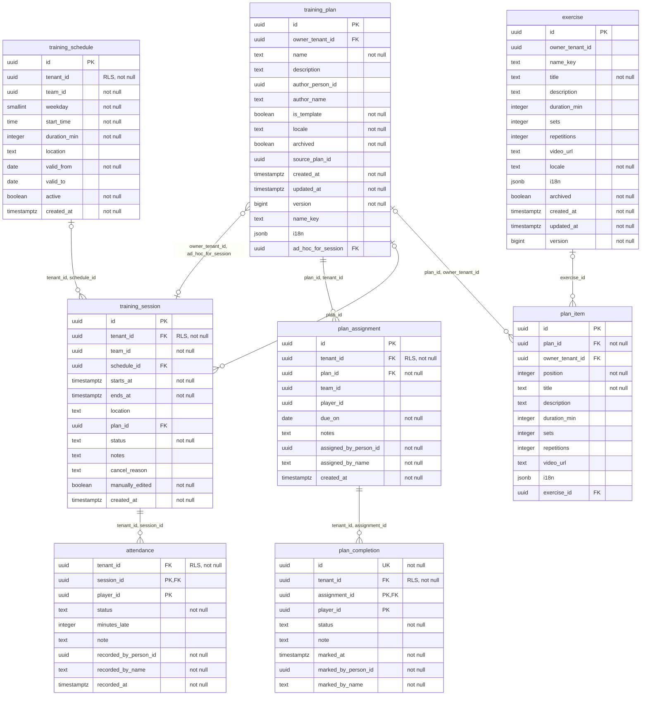

physical_test_norm, physical_test_result, physical_test_type

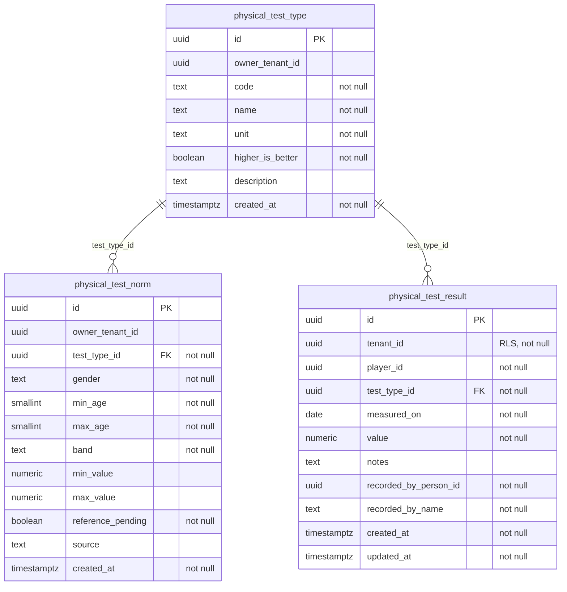

applied_event and 13 more

```mermaid
erDiagram
    applied_event {
        uuid tenant_id PK "RLS"
        uuid event_id PK
        text topic "not null"
        uuid aggregate_id "not null"
        timestamptz occurred_at "not null"
        timestamptz applied_at "not null"
    }
    body_measurement {
        uuid id PK
        uuid tenant_id "RLS, not null"
        uuid player_id "not null"
        date measured_on "not null"
        numeric height_cm
        numeric weight_kg
        uuid recorded_by_person_id "not null"
        text recorded_by_name "not null"
        timestamptz created_at "not null"
        timestamptz updated_at "not null"
    }
    guardian_link_ref {
        uuid tenant_id PK "RLS"
        uuid id PK
        uuid guardian_person_id "not null"
        uuid player_id "not null"
        boolean removed "not null"
        timestamptz occurred_at "not null"
        uuid event_id "not null"
        timestamptz updated_at "not null"
    }
    injury {
        uuid id PK
        uuid tenant_id "RLS, not null"
        uuid player_id "not null"
        date occurred_on "not null"
        text body_part "not null"
        text description
        text severity "not null"
        date expected_return_on
        date actual_return_on
        text status "not null"
        uuid reported_by_person_id "not null"
        text reported_by_name "not null"
        timestamptz created_at "not null"
        timestamptz updated_at "not null"
        bigint version "not null"
    }
    parked_event {
        text topic PK
        integer partition PK
        bigint kafka_offset PK
        text record_key
        uuid event_id
        text reason "not null"
        timestamptz parked_at "not null"
        timestamptz inspected_at
    }
    person_ref {
        uuid tenant_id PK "RLS"
        uuid id PK
        text display_name
        text subject
        text[] roles
        boolean active
        timestamptz occurred_at "not null"
        uuid event_id "not null"
        timestamptz updated_at "not null"
        boolean removed "not null"
    }
    planned_absence {
        uuid id PK
        uuid tenant_id "RLS, not null"
        uuid player_id "not null"
        date from_date "not null"
        date to_date "not null"
        text reason
        uuid created_by_person_id "not null"
        text created_by_name "not null"
        timestamptz created_at "not null"
    }
    player_ref {
        uuid tenant_id PK "RLS"
        uuid id PK
        uuid person_id
        text display_name
        text status
        date birth_date
        text gender
        timestamptz occurred_at "not null"
        uuid event_id "not null"
        timestamptz updated_at "not null"
        boolean removed "not null"
    }
    replica_tenant {
        uuid id PK
        timestamptz first_seen_at "not null"
    }
    team_player_ref {
        uuid tenant_id PK "RLS"
        uuid id PK
        uuid team_id
        uuid player_id
        text jersey_number
        date joined_on
        date left_on
        text invalid_reason
        timestamptz occurred_at "not null"
        uuid event_id "not null"
        timestamptz updated_at "not null"
        boolean removed "not null"
    }
    team_ref {
        uuid tenant_id PK "RLS"
        uuid id PK
        uuid season_id
        date season_end_date
        text name
        timestamptz occurred_at "not null"
        uuid event_id "not null"
        timestamptz updated_at "not null"
        boolean removed "not null"
    }
    team_staff_ref {
        uuid tenant_id PK "RLS"
        uuid id PK
        uuid team_id "not null"
        uuid person_id "not null"
        text role
        date since
        boolean removed "not null"
        timestamptz occurred_at "not null"
        uuid event_id "not null"
        timestamptz updated_at "not null"
    }
    tenant_ref {
        uuid tenant_id PK "RLS"
        text status
        text timezone
        timestamptz occurred_at "not null"
        uuid event_id "not null"
        timestamptz updated_at "not null"
        boolean removed "not null"
    }
    tenant_registry {
        uuid id PK
        text timezone "not null"
        timestamptz updated_at "not null"
    }
```

<!-- END GENERATED: er -->

## Domain classes

<!-- BEGIN GENERATED: domain -->

Training plans

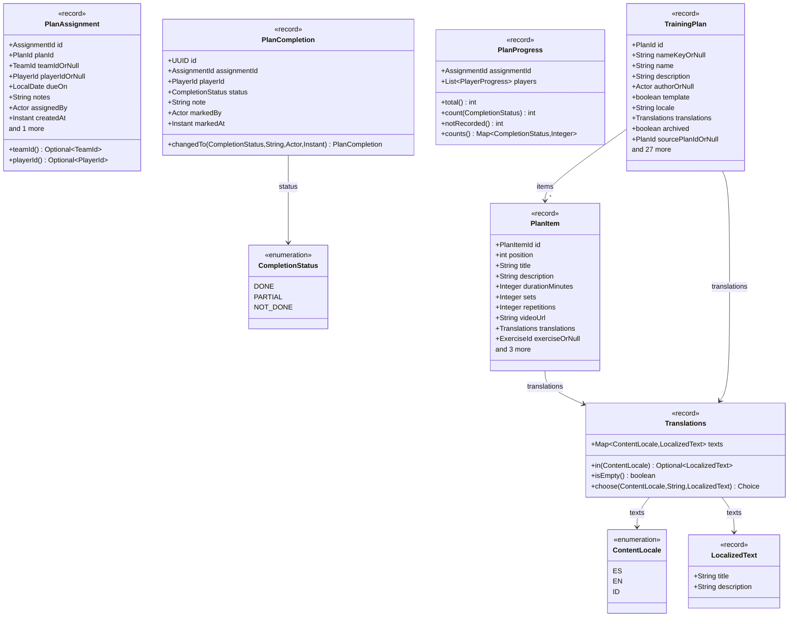

Schedules and sessions

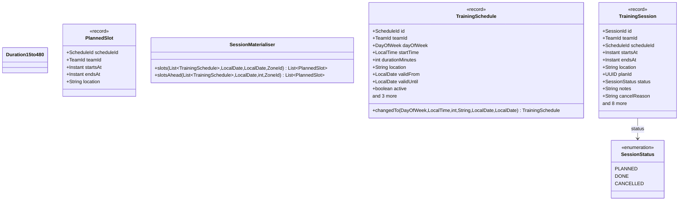

Attendance and absences

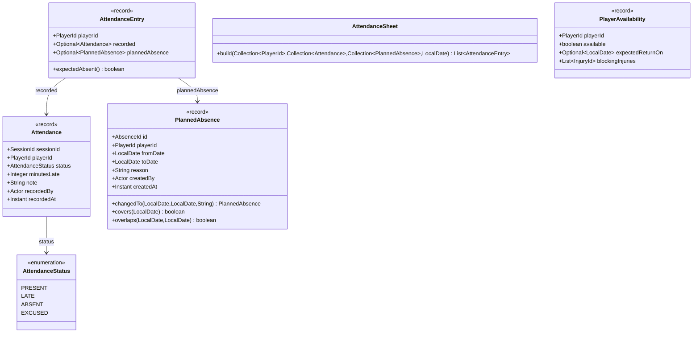

Health and fitness

```mermaid
classDiagram
    class AgeAt {
        +years(LocalDate,LocalDate) int
    }
    class BandResolver {
        +resolve(Collection~PhysicalTestNorm~,Optional~Gender~,OptionalInt,BigDecimal) Resolution
        +effective(Collection~PhysicalTestNorm~) List~PhysicalTestNorm~
        +bandsAreOrdered(Collection~PhysicalTestNorm~,boolean) boolean
    }
    class BodyMeasurement {
        <<record>>
        +BodyMeasurementId id
        +PlayerId playerId
        +LocalDate measuredOn
        +Optional~BigDecimal~ heightCm
        +Optional~BigDecimal~ weightKg
        +Actor recordedBy
        +Instant createdAt
        +Instant updatedAt
        +changedTo(LocalDate,BigDecimal,BigDecimal,Instant) BodyMeasurement
    }
    class Gender {
        <<enumeration>>
        MALE
        FEMALE
    }
    class Injury {
        <<record>>
        +InjuryId id
        +PlayerId playerId
        +LocalDate occurredOn
        +String bodyPart
        +String description
        +InjurySeverity severity
        +Optional~LocalDate~ expectedReturnOn
        +Optional~LocalDate~ actualReturnOn
        +InjuryStatus status
        +Actor reportedBy
        and 4 more
    }
    class InjurySeverity {
        <<enumeration>>
        MINOR
        MODERATE
        SEVERE
    }
    class InjuryStatus {
        <<enumeration>>
        OPEN
        RECOVERED
    }
    class NormBand {
        <<enumeration>>
        POOR
        BELOW_AVERAGE
        AVERAGE
        ABOVE_AVERAGE
        EXCELLENT
    }
    class PhysicalTestNorm {
        <<record>>
        +NormId id
        +TestTypeId testTypeId
        +Gender gender
        +int minAge
        +int maxAge
        +NormBand band
        +Optional~BigDecimal~ minValue
        +Optional~BigDecimal~ maxValue
        +boolean referencePending
        +String source
        and 4 more
    }
    class PhysicalTestResult {
        <<record>>
        +TestResultId id
        +PlayerId playerId
        +TestTypeId testTypeId
        +LocalDate measuredOn
        +BigDecimal value
        +String notes
        +Actor recordedBy
        +Instant createdAt
        +Instant updatedAt
        +changedTo(LocalDate,BigDecimal,String,Instant) PhysicalTestResult
    }
    class PhysicalTestType {
        <<record>>
        +TestTypeId id
        +String code
        +String name
        +String unit
        +boolean higherIsBetter
        +String description
        +boolean global
        +changedTo(String,String,String,boolean,String) PhysicalTestType
    }
    Injury --> InjurySeverity : severity
    Injury --> InjuryStatus : status
    PhysicalTestNorm --> Gender : gender
    PhysicalTestNorm --> NormBand : band
```

Rule violations and actors

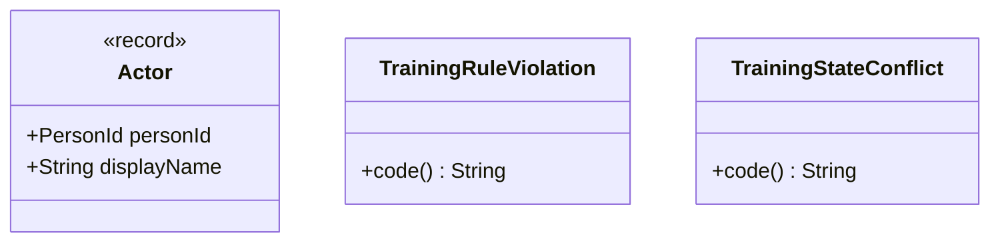

Identifiers

```mermaid
classDiagram
    class AbsenceId {
        <<record>>
        +UUID value
        +toString() String
    }
    class AssignmentId {
        <<record>>
        +UUID value
        +toString() String
    }
    class BodyMeasurementId {
        <<record>>
        +UUID value
        +toString() String
    }
    class ExerciseId {
        <<record>>
        +UUID value
        +toString() String
    }
    class InjuryId {
        <<record>>
        +UUID value
        +toString() String
    }
    class NormId {
        <<record>>
        +UUID value
        +toString() String
    }
    class PersonId {
        <<record>>
        +UUID value
        +toString() String
    }
    class PlanId {
        <<record>>
        +UUID value
        +toString() String
    }
    class PlanItemId {
        <<record>>
        +UUID value
        +toString() String
    }
    class PlayerId {
        <<record>>
        +UUID value
        +toString() String
    }
    class ScheduleId {
        <<record>>
        +UUID value
        +toString() String
    }
    class SessionId {
        <<record>>
        +UUID value
        +toString() String
    }
    class TeamId {
        <<record>>
        +UUID value
        +toString() String
    }
    class TestResultId {
        <<record>>
        +UUID value
        +toString() String
    }
    class TestTypeId {
        <<record>>
        +UUID value
        +toString() String
    }
```

Other domain types

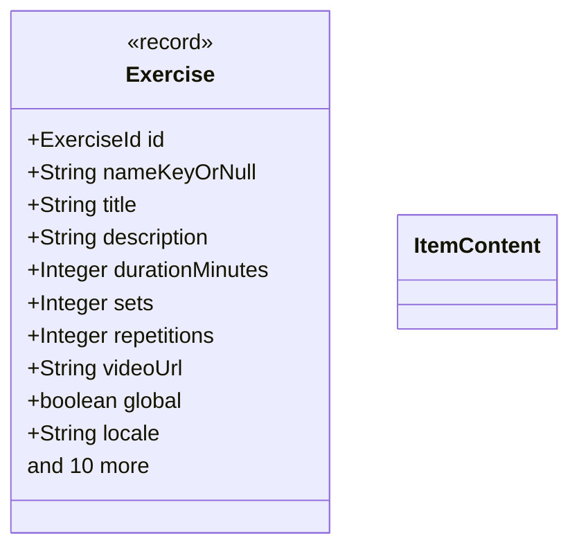

<!-- END GENERATED: domain -->

## Application ports

<!-- BEGIN GENERATED: ports -->

application (root) (1/2)

```mermaid
classDiagram
    class AbsenceRepository {
        <<interface>>
        +save(PlannedAbsence) void
        +find(AbsenceId) Optional~PlannedAbsence~
        +delete(AbsenceId) void
        +search(Collection~PlayerId~,LocalDate,LocalDate,int,int) PageResult~PlannedAbsence~
        +covering(Collection~PlayerId~,LocalDate) List~PlannedAbsence~
        +count() long
    }
    class AssignmentRepository {
        <<interface>>
        +save(PlanAssignment) void
        +find(AssignmentId) Optional~PlanAssignment~
        +delete(AssignmentId) void
        +existsForPlan(PlanId) boolean
        +search(AssignmentQuery) PageResult~PlanAssignment~
        +teamsWithAssignments() List~TeamId~
        +saveCompletion(PlanCompletion) void
        +findCompletion(AssignmentId,PlayerId) Optional~PlanCompletion~
        +completionsOf(AssignmentId) List~PlanCompletion~
        +searchCompletions(CompletionQuery) PageResult~PlanCompletion~
        and 1 more
    }
    class AttendanceRepository {
        <<interface>>
        +findBySession(SessionId) List~Attendance~
        +upsertAll(Collection~Attendance~) void
        +sessionsWithAttendance(Collection~SessionId~) Set~SessionId~
        +count() long
    }
    class ExerciseRepository {
        <<interface>>
        +save(Exercise) void
        +find(ExerciseId) Optional~Exercise~
        +findAll(Collection~ExerciseId~) List~Exercise~
        +search(Search) PageResult~Exercise~
    }
    class InjuryRepository {
        <<interface>>
        +save(Injury) void
        +find(InjuryId) Optional~Injury~
        +delete(InjuryId) void
        +search(Collection~PlayerId~,Optional~InjuryStatus~,Optional~LocalDate~,int,int) PageResult~Injury~
        +openOf(PlayerId) List~Injury~
        +count() long
    }
    class MeasurementRepository {
        <<interface>>
        +save(BodyMeasurement) void
        +find(BodyMeasurementId) Optional~BodyMeasurement~
        +delete(BodyMeasurementId) void
        +existsOn(PlayerId,LocalDate,Optional~BodyMeasurementId~) boolean
        +history(PlayerId,LocalDate,LocalDate) List~BodyMeasurement~
        +count() long
    }
    class NormRepository {
        <<interface>>
        +save(PhysicalTestNorm) void
        +find(NormId) Optional~PhysicalTestNorm~
        +delete(NormId) void
        +list(Optional~TestTypeId~,Optional~Gender~) List~PhysicalTestNorm~
        +forTypes(Collection~TestTypeId~) List~PhysicalTestNorm~
        +tenantNorms(TestTypeId,Gender) List~PhysicalTestNorm~
    }
    class PlanRepository {
        <<interface>>
        +save(TrainingPlan) void
        +find(PlanId) Optional~TrainingPlan~
        +findAll(Collection~PlanId~) List~TrainingPlan~
        +search(Search) PageResult~TrainingPlan~
        +delete(PlanId) void
        +countTenantPlans() long
    }
    class RosterPort {
        <<interface>>
        +teamRoster(TenantId,TeamId) TeamRoster
        +players(TenantId,Collection~PlayerId~) Map~PlayerId,PlayerBrief~
        +playerExists(TenantId,PlayerId) boolean
    }
    class ScheduleRepository {
        <<interface>>
        +save(TrainingSchedule) void
        +find(ScheduleId) Optional~TrainingSchedule~
        +findActive(Optional~TeamId~,Optional~LocalDate~) List~TrainingSchedule~
        +count() long
    }
    class SessionRepository {
        <<interface>>
        +save(TrainingSession) void
        +saveAll(Collection~TrainingSession~) void
        +find(SessionId) Optional~TrainingSession~
        +delete(Collection~SessionId~) void
        +list(SessionQuery) PageResult~TrainingSession~
        +findBySchedules(Collection~ScheduleId~,Instant,Instant) List~TrainingSession~
        +findFutureBySchedule(ScheduleId,Instant) List~TrainingSession~
        +count() long
    }
    class TenantClock {
        <<interface>>
        +now() Instant
        +zoneOf(TenantId) ZoneId
        +today(TenantId) LocalDate
    }
```

application (root) (2/2)

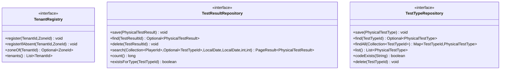

application replica

```mermaid
classDiagram
    class ParkedEvents {
        <<interface>>
        +park(ParkedEvent) void
    }
    class ReplicaHistory {
        <<interface>>
        +tenants() List~TenantId~
        +deleteAppliedBefore(Instant,int) int
        +deleteParkedInspectedBefore(Instant) List~ParkedPosition~
    }
    class ReplicaMembershipReads {
        <<interface>>
        +tenant(TenantId) Optional~TenantState~
        +activeMemberWithLogin(String) Optional~Member~
        +playerOf(PersonId) Optional~PlayerId~
        +guardedPlayers(PersonId) Set~PlayerId~
        +staffTeams(PersonId) Set~TeamId~
        +openValidTeamsOf(Collection~PlayerId~) Set~TeamId~
        +seasonNotEnded(Collection~TeamId~,LocalDate) Set~TeamId~
        +seasonEnded(Collection~TeamId~,LocalDate) Set~TeamId~
    }
    class RosterChange {
        <<interface>>
        +topic() RosterTopic
    }
    class RosterReplicaStore {
        <<interface>>
        +markApplied(RosterEvent) boolean
        +tenant(RosterEvent,TenantChanged) boolean
        +person(RosterEvent,PersonChanged) boolean
        +player(RosterEvent,PlayerChanged) boolean
        +team(RosterEvent,TeamChanged) boolean
        +teamPlayer(RosterEvent,TeamPlayerChanged) boolean
        +teamStaff(RosterEvent,TeamStaffChanged) boolean
        +teamStaffRemoved(RosterEvent,TeamStaffRemoved) boolean
        +guardianLink(RosterEvent,GuardianLinkChanged) boolean
        +guardianLinkRemoved(RosterEvent,GuardianLinkRemoved) boolean
        and 1 more
    }
    class RosterTopic {
        <<enumeration>>
        PERSON
        PLAYER
        TEAM
        TEAM_PLAYER
        TEAM_STAFF
        GUARDIAN_LINK
        TENANT
    }
```

<!-- END GENERATED: ports -->
