# Core-service model

The core service owns tenancy and identity: academies (tenants) with their settings and logo, the people and
app users behind Keycloak logins, memberships and roles, the guardian links, and the roster: seasons, age categories,
teams, staff and players, plus eligibility cases and approvals. It also owns the billing seams (plans and
subscriptions in the `billing` schema), the audit log, usage snapshots, the academy sign-up requests and the outbox
that publishes roster events to the other services. Roles and the rules are in
[authz-matrix.md](authz-matrix.md) and [glossary.md](glossary.md).

The tables and classes below are generated, not drawn: do not edit between the markers. After changing a Flyway
migration or a `domain` / `application` type, run `just diagrams` and commit the page; `just diagrams-check` (and CI)
fails when a page is stale. A table with more than 24 columns is summarised; private members are left out and
long member lists are capped.

## Tables

<!-- BEGIN GENERATED: er -->

billing_plan, billing_tenant_subscription

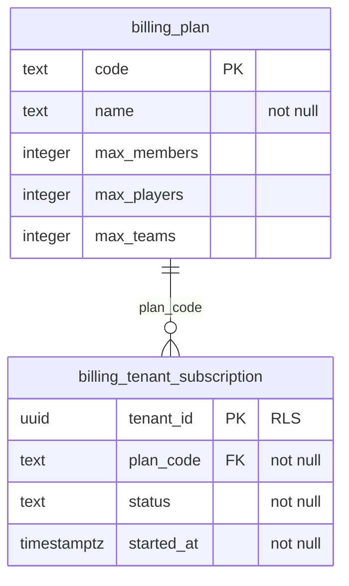

age_category and 12 more

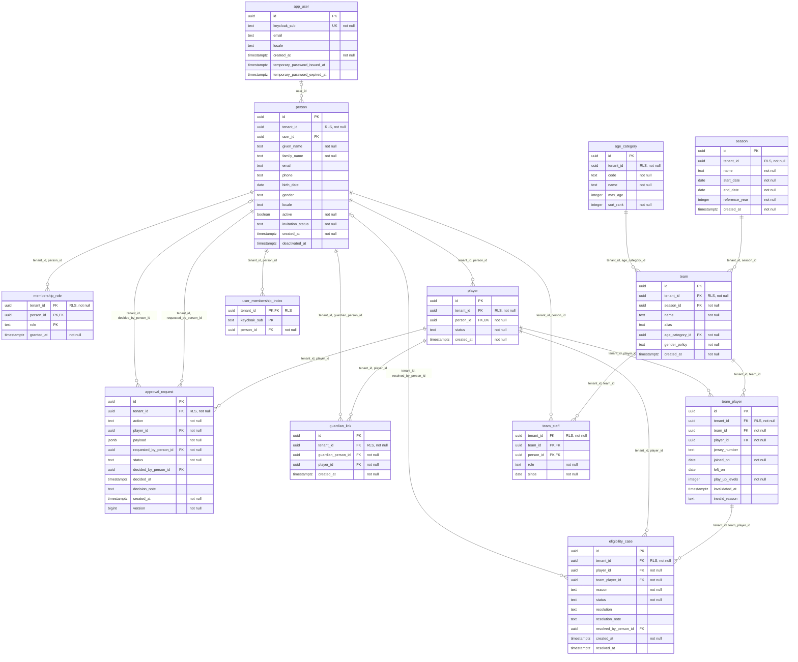

tenant, tenant_settings

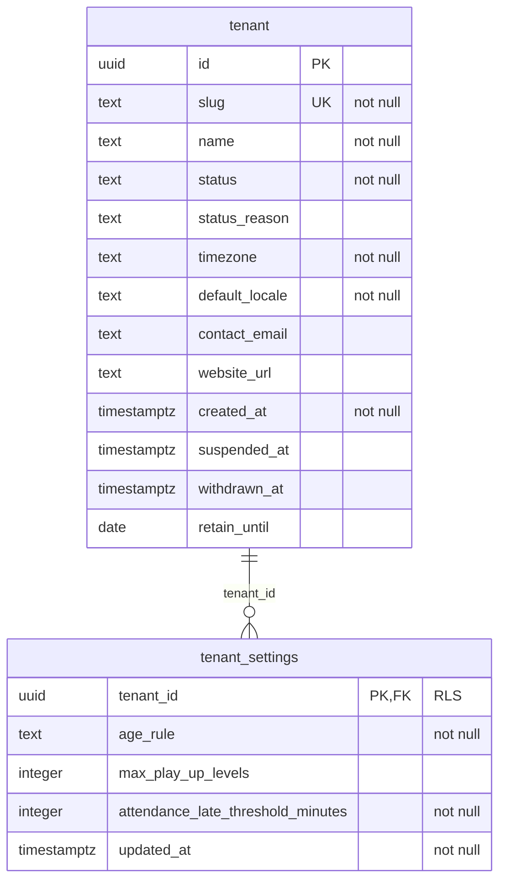

academy_request and 4 more

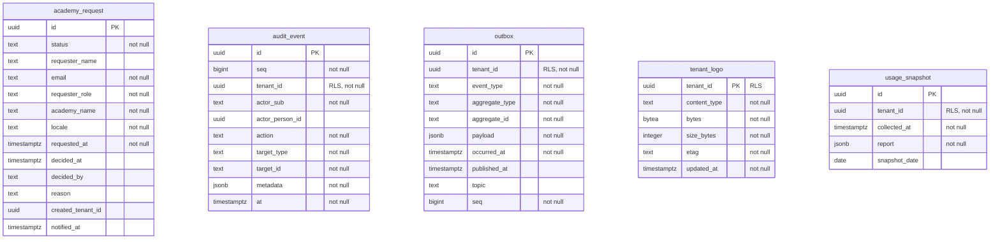

<!-- END GENERATED: er -->

## Domain classes

<!-- BEGIN GENERATED: domain -->

Package approvals

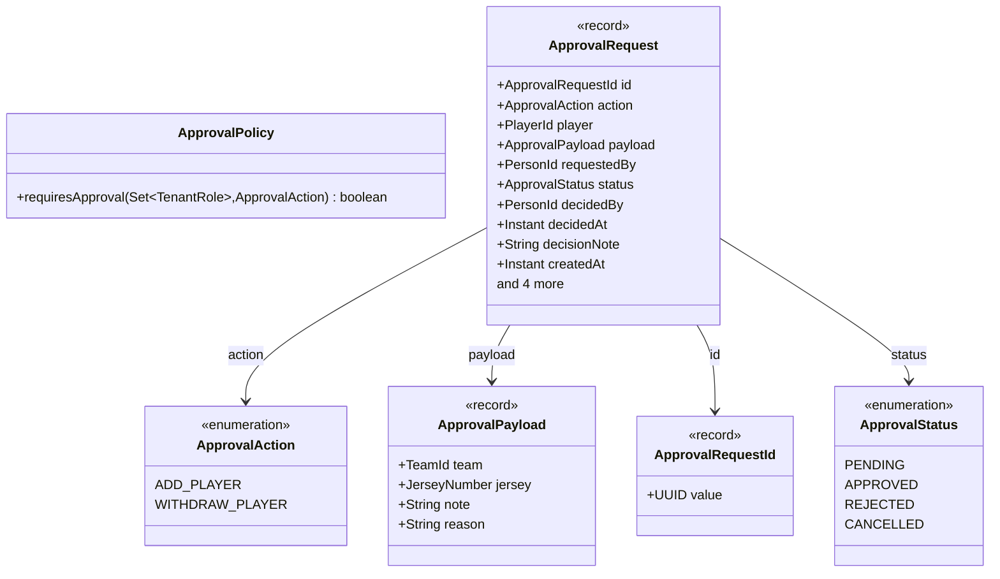

Package eligibility

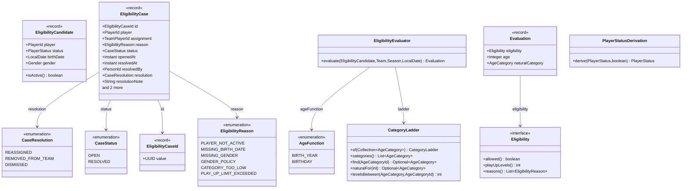

Package identity

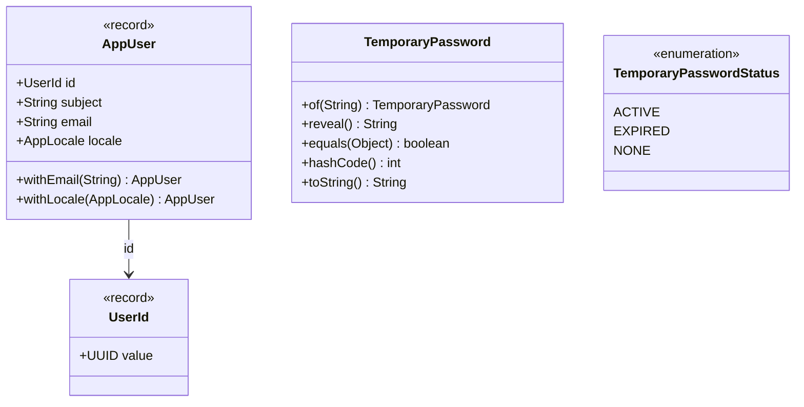

Package logo

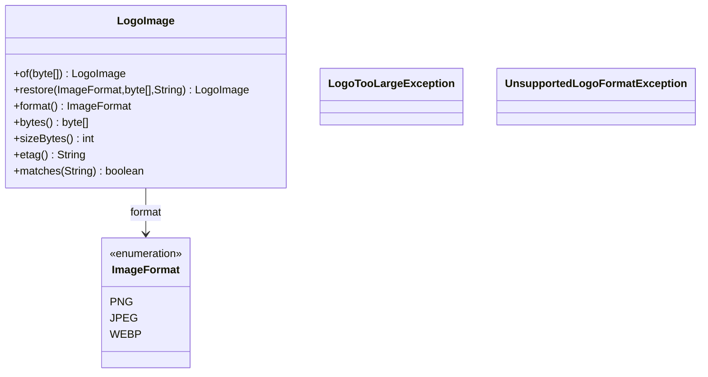

Package membership

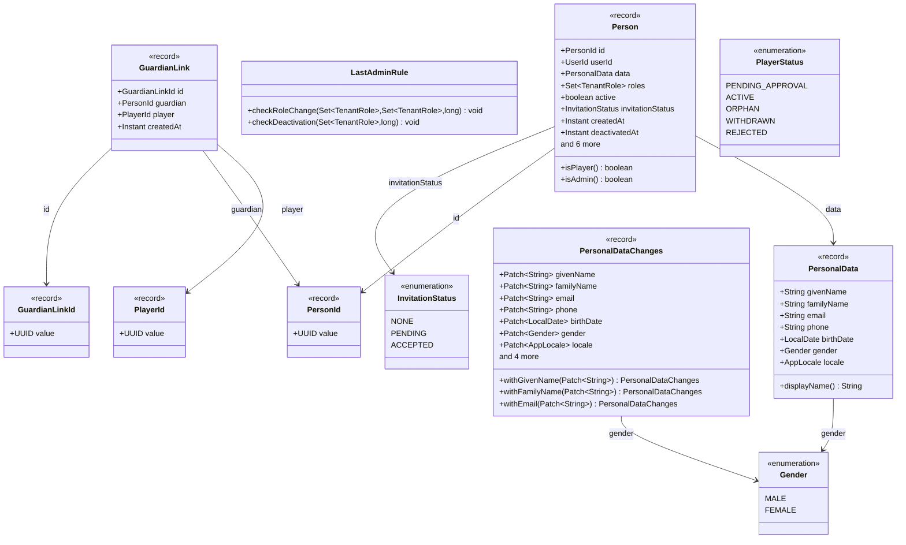

Package roster

```mermaid
classDiagram
    class AgeCategory {
        <<record>>
        +AgeCategoryId id
        +String code
        +String name
        +Integer maxAge
        +int rank
        +isUnlimited() boolean
        +admitsAge(int) boolean
        +apply(AgeCategoryChanges) AgeCategory
    }
    class AgeCategoryChanges {
        <<record>>
        +Patch~String~ code
        +Patch~String~ name
        +Patch~Integer~ maxAge
        +Patch~Integer~ rank
        +changesLadder() boolean
    }
    class AgeCategoryId {
        <<record>>
        +UUID value
    }
    class DefaultAgeCategories {
        +create() List~AgeCategory~
    }
    class EndedSeasons {
        +among(Collection~SeasonId~,Collection~Season~,LocalDate) Set~SeasonId~
    }
    class GenderPolicy {
        <<enumeration>>
        MALE
        FEMALE
        MIXED
    }
    class JerseyNumber {
        <<record>>
        +String value
    }
    class Season {
        <<record>>
        +SeasonId id
        +String name
        +LocalDate startsOn
        +LocalDate endsOn
        +int referenceYear
        +overlaps(Season) boolean
        +isCurrent(LocalDate) boolean
        +hasEnded(LocalDate) boolean
        +apply(SeasonChanges) Season
    }
    class SeasonChanges {
        <<record>>
        +Patch~String~ name
        +Patch~LocalDate~ startsOn
        +Patch~LocalDate~ endsOn
        +Patch~Integer~ referenceYear
        +changesReferenceYear() boolean
    }
    class SeasonId {
        <<record>>
        +UUID value
    }
    class StaffRole {
        <<enumeration>>
        COACH
        ASSISTANT_COACH
    }
    class Team {
        <<record>>
        +TeamId id
        +SeasonId season
        +String name
        +String alias
        +AgeCategoryId category
        +GenderPolicy genderPolicy
        +apply(TeamChanges) Team
        +cloneInto(SeasonId) Team
    }
    class TeamChanges {
        <<record>>
        +Patch~String~ name
        +Patch~String~ alias
        +Patch~AgeCategoryId~ category
        +Patch~GenderPolicy~ genderPolicy
        +changesEligibility() boolean
    }
    class TeamId {
        <<record>>
        +UUID value
    }
    class TeamPlayer {
        <<record>>
        +TeamPlayerId id
        +TeamId team
        +PlayerId player
        +JerseyNumber jersey
        +LocalDate joinedOn
        +LocalDate leftOn
        +int playUpLevels
        +Instant invalidatedAt
        +EligibilityReason invalidReason
        +isOpen() boolean
        and 4 more
    }
    class TeamPlayerId {
        <<record>>
        +UUID value
    }
    class TeamStaffMember {
        <<record>>
        +TeamId team
        +PersonId person
        +StaffRole role
        +LocalDate since
        +withRole(StaffRole) TeamStaffMember
        +forTeam(TeamId,LocalDate) TeamStaffMember
    }
    AgeCategory --> AgeCategoryId : id
    Season --> SeasonId : id
    Team --> AgeCategoryId : category
    Team --> GenderPolicy : genderPolicy
    Team --> SeasonId : season
    Team --> TeamId : id
    TeamChanges --> AgeCategoryId : category
    TeamChanges --> GenderPolicy : genderPolicy
    TeamPlayer --> JerseyNumber : jersey
    TeamPlayer --> TeamId : team
    TeamPlayer --> TeamPlayerId : id
    TeamStaffMember --> StaffRole : role
    TeamStaffMember --> TeamId : team
```

Package shared

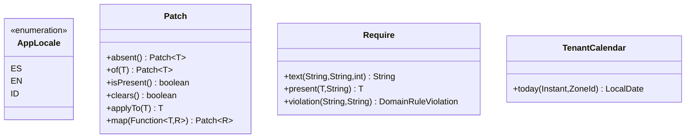

Package signup

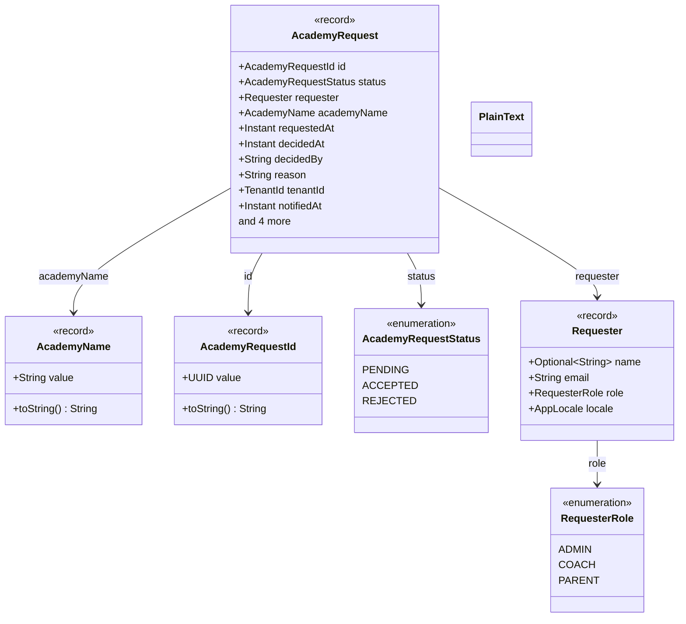

Package tenant

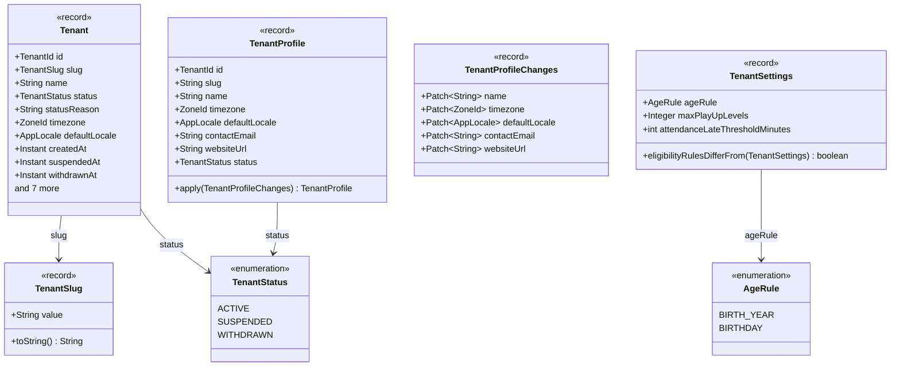

<!-- END GENERATED: domain -->

## Application ports

<!-- BEGIN GENERATED: ports -->

application audit

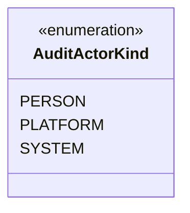

application events

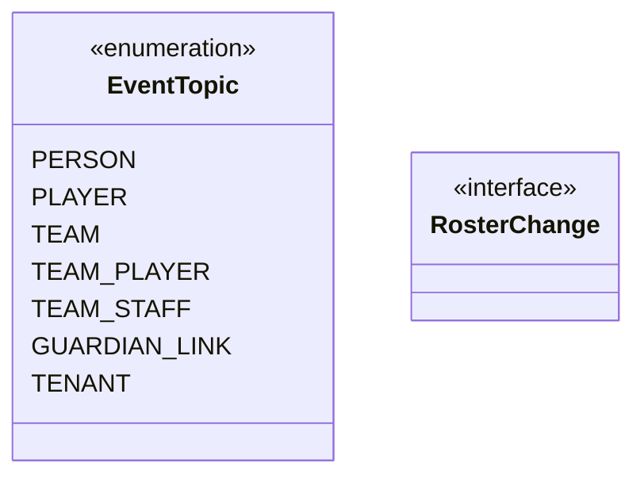

application port (1/4)

```mermaid
classDiagram
    class AcademyRequestNotifier {
        <<interface>>
        +accepted(AcademyRequest,boolean) boolean
        +rejected(AcademyRequest) boolean
    }
    class AcademyRequestRepository {
        <<interface>>
        +insert(AcademyRequest) void
        +tenantNamed(AcademyName) boolean
        +openRequestNamed(AcademyName) boolean
        +pendingFor(String) long
        +find(AcademyRequestId) Optional~AcademyRequest~
        +list(Optional~AcademyRequestStatus~,PageRequest) PageResult~AcademyRequest~
        +decide(AcademyRequest) boolean
        +reopen(AcademyRequestId,TenantId) void
        +markNotified(AcademyRequest) void
    }
    class AgeCategoryRepository {
        <<interface>>
        +insert(AgeCategory) void
        +update(AgeCategory) void
        +delete(AgeCategoryId) void
        +find(AgeCategoryId) Optional~AgeCategory~
        +listByRank() List~AgeCategory~
    }
    class AppUserRepository {
        <<interface>>
        +findBySubject(String) Optional~AppUser~
        +findById(UserId) Optional~AppUser~
        +findOrRegister(String,String) AppUser
        +save(AppUser) void
    }
    class ApprovalRepository {
        <<interface>>
        +insert(ApprovalRequest) void
        +update(ApprovalRequest) void
        +find(ApprovalRequestId) Optional~ApprovalRequest~
        +list(ApprovalFilter,PageRequest) PageResult~ApprovalRequest~
        +addRequesters(Collection~PlayerId~) Map~PlayerId,PersonId~
        +countPending() long
    }
    class AuditAction {
        <<enumeration>>
        ADMIN_ADDED
        ADMIN_REMOVED
        ADMIN_TEMPORARY_PASSWORD_ISSUED
        ADMIN_UPDATED
        APPROVAL_CANCELLED
        GUARDIAN_LINK_CREATED
        GUARDIAN_LINK_REMOVED
        MEMBER_DEACTIVATED
        and 22 more
    }
    class AuditLog {
        <<interface>>
        +record(AuditEvent) void
        +recordAs(PersonId,AuditEvent) void
        +recordFor(TenantId,AuditEvent) void
    }
    class AuditNames {
        <<interface>>
        +persons(Set~UUID~) Map~UUID,String~
        +players(Set~UUID~) Map~UUID,String~
        +tenants(Set~UUID~) Map~UUID,String~
        +activeAdmins(Set~UUID~) Map~UUID,String~
    }
    class AuditTargetType {
        <<enumeration>>
        PERSON
        PLAYER
        TENANT
        APPROVAL_REQUEST
        GUARDIAN_LINK
    }
    class AuditTrail {
        <<interface>>
        +list(AuditFilter,PageRequest) PageResult~AuditRecord~
    }
    class EligibilityCaseRepository {
        <<interface>>
        +insert(EligibilityCase) void
        +update(EligibilityCase) void
        +find(EligibilityCaseId) Optional~CaseOfTeam~
        +openOfPlayer(PlayerId) List~EligibilityCase~
        +list(CaseFilter,PageRequest) PageResult~CaseOfTeam~
    }
    class EntitlementService {
        <<interface>>
        +check(TenantId,Limit) void
    }
    AuditAction --> AuditTargetType : targetType
```

application port (2/4)

```mermaid
classDiagram
    class EventBroker {
        <<interface>>
        +send(String,String,String) void
    }
    class GuardianLinkRepository {
        <<interface>>
        +insert(GuardianLink) void
        +exists(PersonId,PlayerId) boolean
        +find(GuardianLinkId) Optional~GuardianLink~
        +delete(GuardianLinkId) void
        +list(Optional~PlayerId~,Optional~PersonId~,PageRequest) PageResult~GuardianLink~
        +playersOf(PersonId) Set~PlayerId~
    }
    class IdentityProviderPort {
        <<interface>>
        +provision(NewIdentity) ProvisionedIdentity
        +setTemporaryPassword(String,TemporaryPassword) void
        +hasOwnPassword(String) boolean
        +updateLogin(LoginUpdate) void
        +disable(String) void
        +enable(String) void
        +delete(String) void
    }
    class LogoRepository {
        <<interface>>
        +find() Optional~StoredLogo~
        +findEtag() Optional~String~
        +save(LogoImage,Instant) StoredLogo
        +delete() boolean
    }
    class MembershipRepository {
        <<interface>>
        +register(String,PersonId) void
        +unregister(PersonId) void
        +ofSubject(String) List~IndexedMembership~
        +linkedInAnotherTenant(String) boolean
        +inOtherTenants(String) List~IndexedMembership~
    }
    class OutboxBacklog {
        <<interface>>
        +pendingByTenant() List~TenantBacklog~
    }
    class OutboxQueue {
        <<interface>>
        +lockNext(int) List~PendingEvent~
        +markPublished(Collection~UUID~) void
    }
    class OutboxWriter {
        <<interface>>
        +write(OutboxEvent) void
    }
    class PendingLoginPersons {
        <<interface>>
        +recordForEach(String,UserId,Function~PersonId,AuditEvent~) int
    }
    class PersonRepository {
        <<interface>>
        +insert(Person) void
        +update(Person) void
        +find(PersonId) Optional~Person~
        +findAll(Collection~PersonId~) List~Person~
        +findActiveByLogin(String) Optional~Person~
        +findByEmail(String) Optional~Person~
        +emailTaken(String,Optional~PersonId~) boolean
        +loginLinked(UserId) boolean
        +countActiveAdmins() long
        +countActive() long
        and 2 more
    }
    class PlatformAuditLog {
        <<interface>>
        +record(TenantId,AuditEvent) void
    }
    class PlatformAuditTrail {
        <<interface>>
        +list(Optional~TenantId~,AuditFilter,PageRequest) PageResult~Row~
    }
```

application port (3/4)

```mermaid
classDiagram
    class PlatformOutboxWriter {
        <<interface>>
        +write(OutboxEvent) void
    }
    class PlatformUsers {
        <<interface>>
        +list(Optional~String~,PageRequest) PageResult~Login~
    }
    class PlayerRepository {
        <<interface>>
        +create(PersonId,PlayerStatus) PlayerId
        +findByPerson(PersonId) Optional~PlayerId~
        +findByPersons(Collection~PersonId~) Map~PersonId,PlayerId~
        +personOf(PlayerId) Optional~PersonId~
        +summary(PlayerId) Optional~PlayerSummary~
        +summaries(Collection~PlayerId~) Map~PlayerId,PlayerSummary~
        +find(PlayerId) Optional~PlayerRow~
        +page(PlayerFilter,PageRequest) PageResult~PlayerRow~
        +updateStatus(PlayerId,PlayerStatus) void
        +count() long
        and 2 more
    }
    class RemoteUsagePort {
        <<interface>>
        +service() String
        +fetch(TenantId) Optional~UsageReport~
    }
    class RosterInventory {
        <<interface>>
        +live(EventTopic) List~RosterChange~
        +withEvents(EventTopic,long) Set~String~
        +lastSeq() long
    }
    class RosterStates {
        <<interface>>
        +person(PersonId) Optional~PersonState~
        +player(PlayerId) Optional~PlayerState~
        +team(TeamId) Optional~TeamState~
        +teamsOfSeason(SeasonId) List~TeamId~
        +teamPlayer(TeamPlayerId) Optional~TeamPlayerState~
        +teamStaff(TeamId,PersonId) Optional~TeamStaffState~
        +guardianLink(GuardianLinkId) Optional~GuardianLinkState~
        +tenant() Optional~TenantState~
    }
    class SeasonRepository {
        <<interface>>
        +insert(Season) void
        +update(Season) void
        +find(SeasonId) Optional~Season~
        +listNewestFirst() List~Season~
        +notEndedOn(LocalDate) List~Season~
        +count() long
    }
    class SharedLoginPersons {
        <<interface>>
        +emailTaken(IndexedMembership,String) boolean
        +changeEmail(IndexedMembership,UserId,String,AuditEvent) boolean
    }
    class StaffTeamsQuery {
        <<interface>>
        +staffTeamsOf(PersonId) Set~UUID~
    }
    class SubscriptionRepository {
        <<interface>>
        +subscribe(TenantId,String) void
        +deleteUnprovisioned(TenantId) void
    }
    class TeamPlayerRepository {
        <<interface>>
        +insert(TeamPlayer) void
        +update(TeamPlayer) void
        +find(TeamPlayerId) Optional~TeamPlayer~
        +findOpen(TeamId,PlayerId) Optional~TeamPlayer~
        +ofTeam(TeamId,boolean) List~TeamPlayer~
        +openValidOfTeams(Collection~TeamId~) List~TeamPlayer~
        +openOfPlayers(Collection~PlayerId~) List~TeamPlayer~
        +jerseyTaken(TeamId,JerseyNumber,Optional~TeamPlayerId~) boolean
        +countOpenValid(Collection~TeamId~) Map~TeamId,Long~
    }
    class TeamRepository {
        <<interface>>
        +insert(Team) void
        +update(Team) void
        +find(TeamId) Optional~Team~
        +findAll(Collection~TeamId~) List~Team~
        +inSeasons(Collection~SeasonId~) List~Team~
        +seasonNotEnded(Collection~TeamId~,LocalDate) Set~TeamId~
        +list(TeamFilter,PageRequest) PageResult~Team~
        +nameTaken(SeasonId,String,Optional~TeamId~) boolean
        +usesCategory(AgeCategoryId) boolean
        +count() long
    }
```

application port (4/4)

```mermaid
classDiagram
    class TeamStaffRepository {
        <<interface>>
        +ofTeam(TeamId) List~TeamStaffMember~
        +find(TeamId,PersonId) Optional~TeamStaffMember~
        +save(TeamStaffMember) void
        +delete(TeamId,PersonId) void
        +teamsOf(PersonId) Set~TeamId~
    }
    class TemporaryPasswordLogins {
        <<interface>>
        +issued(String,Instant) boolean
        +due(Instant) List~String~
        +lockIfDue(String,Instant) Optional~UserId~
        +expired(String,Instant) void
        +used(String) void
        +statusOf(Collection~UserId~) Map~UserId,TemporaryPasswordStatus~
    }
    class TemporaryPasswordSweeps {
        <<interface>>
        +request() void
    }
    class TenantProfileRepository {
        <<interface>>
        +findCurrent() Optional~TenantProfile~
        +save(TenantProfile) void
    }
    class TenantRepository {
        <<interface>>
        +slugExists(TenantSlug) boolean
        +insert(Tenant) void
        +update(Tenant) void
        +find(TenantId) Optional~Tenant~
        +list(Optional~TenantStatus~,Optional~String~,PageRequest) PageResult~Tenant~
        +ids() List~TenantId~
        +createdBetween(Instant,Instant) List~TenantId~
        +deleteUnprovisioned(TenantId) void
    }
    class TenantSettingsRepository {
        <<interface>>
        +create(TenantSettings) void
        +findCurrent() Optional~TenantSettings~
        +save(TenantSettings) void
    }
    class UsageCounter {
        <<interface>>
        +counters() Map~String,Long~
    }
    class UsageSnapshotRepository {
        <<interface>>
        +save(TenantId,Instant,Object) void
        +history(TenantId,LocalDate,LocalDate) List~DailySnapshot~
    }
```

application tenant

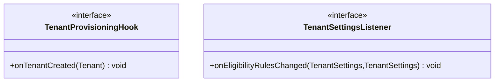

<!-- END GENERATED: ports -->
