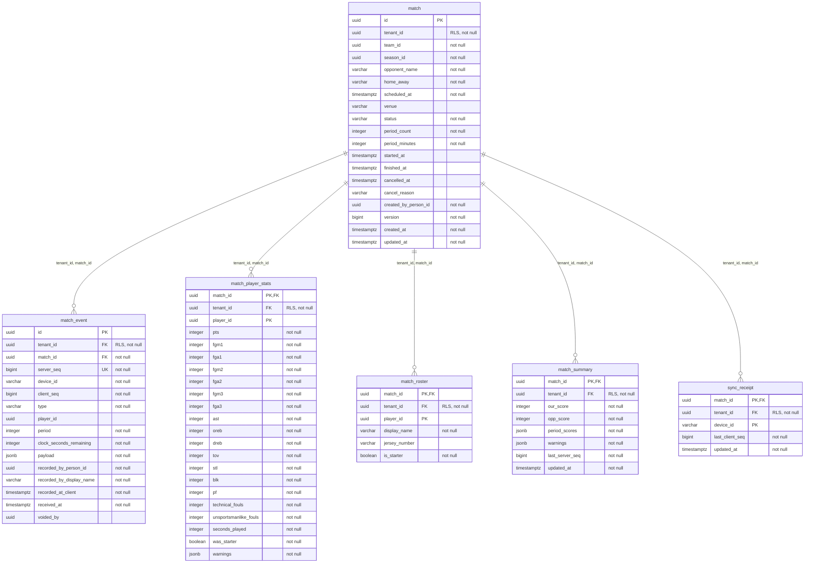
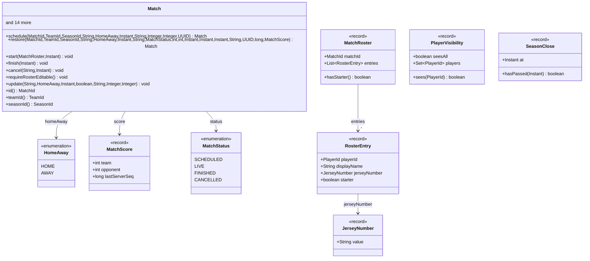
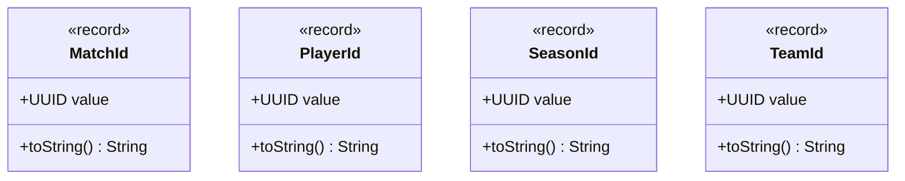
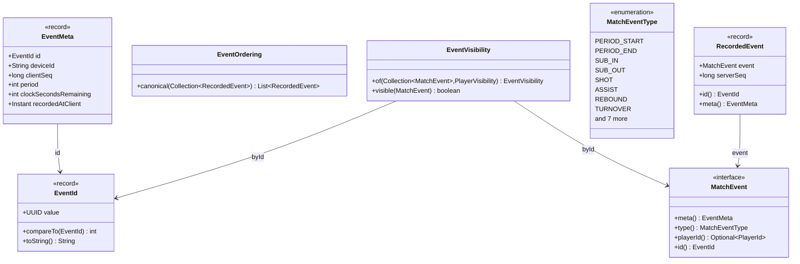
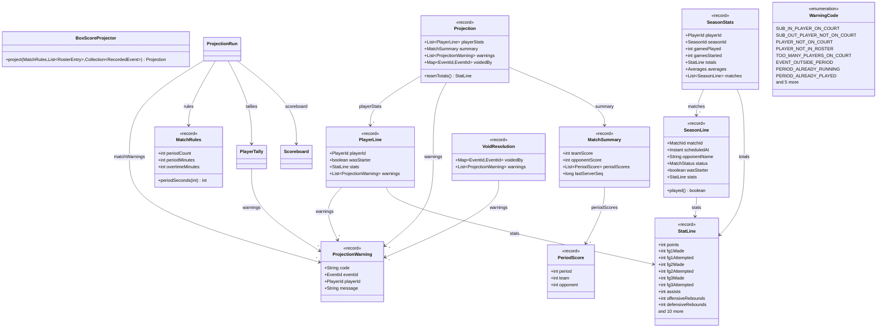
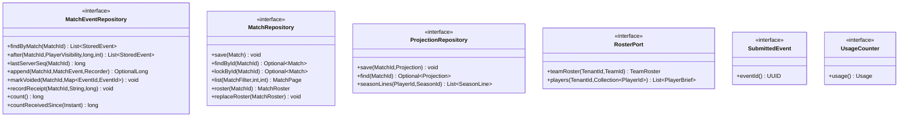
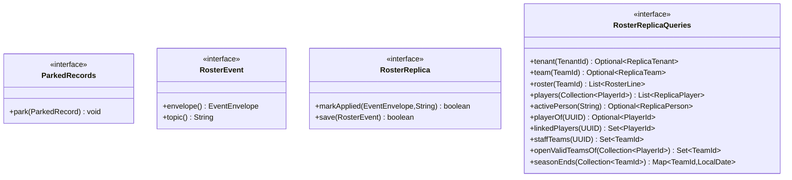

# Game-service model

The game service owns live match statistics: matches and their rosters, the append-only event log recorded
offline-first by the scorer, and the projections computed from it (box score, scoreboard, season statistics). It
keeps read-only replicas of the roster (`*_ref` tables, fed by core's roster events) so a match can be played without
calling core. Match and projection rules are in [glossary.md](glossary.md).

The tables and classes below are generated, not drawn: do not edit between the markers. After changing a Flyway
migration or a `domain` / `application` type, run `just diagrams` and commit the page; `just diagrams-check` (and CI)
fails when a page is stale. A table with more than 24 columns is summarised; private members are left out and
long member lists are capped.

## Tables

<!-- BEGIN GENERATED: er -->

match and 5 more

applied_event and 9 more

<!-- END GENERATED: er -->

```mermaid
erDiagram
    applied_event {
        uuid tenant_id PK "RLS"
        uuid event_id PK
        text topic "not null"
        timestamptz applied_at "not null"
    }
    guardian_link_ref {
        uuid tenant_id PK "RLS"
        uuid id PK
        uuid guardian_person_id "not null"
        uuid player_id "not null"
        boolean removed "not null"
        timestamptz occurred_at "not null"
        uuid event_id "not null"
    }
    parked_event {
        bigint id PK
        text topic "not null"
        integer kafka_partition "not null"
        bigint kafka_offset "not null"
        text record_key
        uuid event_id
        text reason "not null"
        timestamptz parked_at "not null"
        timestamptz inspected_at
    }
    person_ref {
        uuid tenant_id PK "RLS"
        uuid id PK
        text display_name
        text subject
        text[] roles
        boolean active
        timestamptz occurred_at "not null"
        uuid event_id "not null"
        boolean removed "not null"
    }
    player_ref {
        uuid tenant_id PK "RLS"
        uuid id PK
        uuid person_id
        text display_name
        text status
        date birth_date
        text gender
        timestamptz occurred_at "not null"
        uuid event_id "not null"
        boolean removed "not null"
    }
    replica_tenant {
        uuid id PK
        timestamptz first_seen_at "not null"
    }
    team_player_ref {
        uuid tenant_id PK "RLS"
        uuid id PK
        uuid team_id
        uuid player_id
        text jersey_number
        date joined_on
        date left_on
        text invalid_reason
        timestamptz occurred_at "not null"
        uuid event_id "not null"
        boolean removed "not null"
    }
    team_ref {
        uuid tenant_id PK "RLS"
        uuid id PK
        uuid season_id
        date season_end_date
        text name
        timestamptz occurred_at "not null"
        uuid event_id "not null"
        boolean removed "not null"
    }
    team_staff_ref {
        uuid tenant_id PK "RLS"
        uuid id PK
        uuid team_id "not null"
        uuid person_id "not null"
        text role
        boolean removed "not null"
        timestamptz occurred_at "not null"
        uuid event_id "not null"
    }
    tenant_ref {
        uuid tenant_id PK "RLS"
        text status
        text timezone
        timestamptz occurred_at "not null"
        uuid event_id "not null"
        boolean removed "not null"
    }
```

## Domain classes

<!-- BEGIN GENERATED: domain -->

Match

Identifiers

Package events

Package projection

<!-- END GENERATED: domain -->

## Application ports

<!-- BEGIN GENERATED: ports -->

application (root)

application replica

<!-- END GENERATED: ports -->
